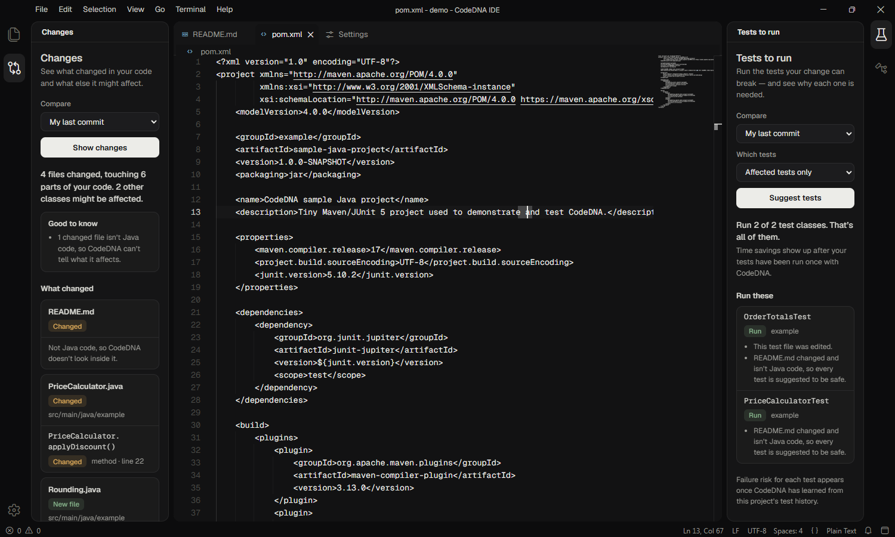

# CodeDNA

**Risk-calibrated change-impact analysis and regression test selection for
Java projects in continuous integration.** A Software Engineering Final Year
Project.

Given a Git repository and two commits, CodeDNA will eventually work out which
code changed, what it may affect, which regression tests matter, and how risky
it is to skip the rest — and explain every decision.

**Where it is heading:** a platform — the Python analysis core, downloadable
language plugins (Java first), the **CodeDNA IDE** built on Eclipse Theia,
and a platform website with a plugin catalogue. Only the analysis core exists
today; see [docs/ROADMAP.md](docs/ROADMAP.md) and decisions D-017 – D-020 in
[docs/DECISIONS.md](docs/DECISIONS.md).

**Status:** Milestones 0–3 done; Milestone 4 and 5 tooling done — waiting for
real study data, so **no research results exist yet**.
Today CodeDNA can:

- report changes between two commits: files, line ranges, and the Java
  **classes, methods, constructors and fields** they touch (`analyze`);
- export a **code dependency graph** of any commit, with every edge labelled
  `confirmed` or `heuristic` and unresolved names listed separately (`graph`);
- list types **potentially impacted** by a change, each with an explanation
  path, plus the test classes that depend on them (`impact`);
- discover JUnit 4/5 test classes statically (`tests`);
- run a commit's Maven test suite in an isolated export, optionally with
  **per-test JaCoCo coverage** (`run-tests`, only with `--allow-build`);
- select tests with three baselines — retest-all, dependency-only and
  coverage-based — and compare them against a full run (`select`, `compare`).

Analysis commands parse code with Tree-sitter and never build or execute it;
only `run-tests` executes the project, and only when you pass `--allow-build`.
History mining and ML are not implemented yet — see
[docs/ROADMAP.md](docs/ROADMAP.md).

## Prerequisites

| Tool | Version | Needed for |
|------|---------|-----------|
| Python | 3.11 or newer | CodeDNA itself |
| Git | 2.24 or newer | Change extraction |
| Java (JDK) | 17 | `run-tests` and the sample project |
| Maven | 3.9+ | `run-tests` (everything else works without it) |

## Setup

Windows (PowerShell):

```powershell
py -3.12 -m venv .venv
.venv\Scripts\Activate.ps1
python -m pip install -e ".[dev]"
```

macOS / Linux:

```bash
python3 -m venv .venv
source .venv/bin/activate
python -m pip install -e ".[dev]"
```

Installing needs internet once (it downloads the `tree-sitter` and
`tree-sitter-java` wheels, which include the compiled Java grammar). After
that, analysis and tests run fully offline.

## Run the tests

```bash
python -m pytest
```

One end-to-end test runs real Maven + JaCoCo on the sample project. It is
skipped by default because it needs Maven, a JDK and internet access (Maven
downloads plugins); CI runs it. To run it locally:

```bash
python -m pytest -m maven --run-maven
```

## Usage

```bash
codedna analyze --repo PATH --base BASE_REV --head HEAD_REV [--level method|file] [--output FILE]
codedna graph   --repo PATH [--rev REV] [--no-members] [--output FILE]
codedna impact  --repo PATH --base BASE_REV --head HEAD_REV [--max-depth N] [--confirmed-only] [--output FILE]
codedna tests   --repo PATH [--rev REV] [--output FILE]
codedna run-tests --repo PATH [--rev REV] --output-dir DIR --allow-build [--per-test-coverage] [--mvn PATH] [--timeout S]
codedna select  --repo PATH --base BASE_REV --head HEAD_REV --strategy all|dependency|coverage [--coverage-map F] [--durations F] [--non-java retest-all|ignore]
codedna compare --repo PATH --base BASE_REV --head HEAD_REV --ground-truth F [--coverage-map F] [--non-java retest-all|ignore]
codedna plugins
codedna serve   [--host 127.0.0.1] [--port 8765] [--allow-build]
codedna history mine     --repo PATH --db FILE [--rev REV] [--max-commits N]
codedna history import   --db FILE RESULTS [RESULTS ...] [--source NAME]
codedna history collect  --repo PATH --db FILE --output-dir DIR --allow-build [--max-commits N]
codedna history status   --db FILE
codedna history evaluate --db FILE [--repo PATH] [--rankers ...] [--no-structural] [--dataset-csv F]
codedna history import-rtptorrent --dataset DIR (--list | --project NAME --db FILE) [--max-commits N]
codedna history experiment --db FILE [--repo PATH] [--model M] [--calibration none|platt|isotonic] [--budget F] [--risk-target F]
codedna history risk --db FILE --base REV [--head REV] [--repo PATH] [--risk-target F] [--no-structural]
```

- `analyze --level method` (default) adds a `java` object to every changed
  Java file; `--level file` skips Java parsing.
- `graph` exports packages, files, types and members of one commit (default
  `HEAD`) with `contains`, `extends`, `implements`, `uses`, `imports` and
  `static_access` edges. `--no-members` leaves out method/field nodes.
- `impact` follows dependency edges backwards from the changed types.
  `--max-depth` limits the number of hops; `--confirmed-only` ignores
  heuristic edges.
- `tests` lists JUnit test classes and whether Surefire runs them by default.
- `run-tests` **executes the project's code and build plugins**, so it refuses
  to start without `--allow-build`. It exports the commit with `git archive`
  into `DIR/checkout` (your working tree and `pom.xml` are never touched),
  runs `mvn test`, and writes `DIR/results.json`. `--per-test-coverage` runs
  every test class separately under JaCoCo and also writes
  `DIR/coverage-map.json` (slow: one Maven run per test class).
- `select` picks tests for a change: `all` (retest-all), `dependency` (static
  graph) or `coverage` (needs a coverage map recorded at BASE). Changed tests
  are always selected; a changed non-Java file falls back to retest-all unless
  `--non-java ignore`. `--durations` adds a time estimate.
- `compare` runs all strategies against a full run of HEAD (`--ground-truth`)
  and reports selection ratio, estimated time, and failing tests caught/missed.
  Files and run directories are both accepted for `--coverage-map`,
  `--durations` and `--ground-truth`.
- `plugins` lists installed language plugins (Java is built in).
- `serve` starts the **local API for the CodeDNA IDE** (needs
  `pip install -e ".[api]"`, included in `.[dev]`). It listens on loopback
  only and prints one JSON line with the URL and a session token
  (`CODEDNA_API_TOKEN` overrides it); every request except
  `/api/health` needs the `X-CodeDNA-Token` header. Endpoints mirror the CLI
  (`/api/analyze`, `/api/graph`, `/api/impact`, `/api/tests`, `/api/select`,
  `/api/compare`, `/api/run-tests`); `/api/run-tests` additionally needs
  `--allow-build` on the server and `"allow_build": true` in the request.
  Interactive docs: `http://127.0.0.1:8765/docs`.
- `history` builds a per-repository SQLite database: `mine` stores the
  first-parent commits, `import` stores `results.json` files, `collect`
  runs the full suite of each mined commit (**executes project code**, needs
  `--allow-build`, slow), and `evaluate` builds leakage-free features and
  compares orderings (random, shortest-first, recent failures, failure
  history, logistic regression, gradient boosting) on a chronological
  60/20/20 split. ML needs scikit-learn (`pip install -e ".[ml]"`; included
  in `.[dev]`).
- `history import-rtptorrent` fills a history database from the
  [RTPTorrent](https://zenodo.org/records/4046180) dataset (real Travis CI
  test results for 20 Java projects, CC BY 4.0; Mattis et al., MSR 2020)
  without building anything; `--list` shows the projects.
- `history experiment` is the Milestone 5 study: train on the oldest 60 %,
  calibrate on the next 20 %, then compare retest-all (B0), dependency (B4),
  change-only ML (B6), uncalibrated ML (B7), calibrated ML (B8) and
  calibrated ML with risk target + fallback (B9) on the latest 20 %, plus
  calibration quality, budget/risk sweeps and feature ablations. The report
  includes a dataset hash, seed and package versions for reproducibility.

`BASE_REV`/`HEAD_REV` can be full or short SHAs, branches, tags or expressions
like `HEAD~1`. They are resolved to full SHAs in the output.
`python -m codedna ...` works too.

Exit codes: `0` success · `1` bad repository / unknown commit / Git error ·
`2` invalid command-line arguments.

## Demo: analyse a real change

`scripts/make_demo_repo.py` copies the sample Java project into a new Git
repository, commits it, then makes a second commit that modifies a method,
adds a class, renames a test and edits a README.

```bash
python scripts/make_demo_repo.py ../codedna-demo
```

It prints the two SHAs and the exact command to run, for example:

```bash
codedna analyze --repo ../codedna-demo --base <BASE_SHA> --head <HEAD_SHA>
```

Excerpt of real output from the demo repository (line ranges compacted onto
one line for readability):

```json
{
  "path": "src/main/java/example/PriceCalculator.java",
  "status": "modified",
  "old_path": null,
  "similarity": null,
  "is_java": true,
  "is_binary": false,
  "changed_lines": [[23, 24]],
  "removed_lines": [[23, 23]],
  "java": {
    "package": "example",
    "declarations": [
      {
        "id": "example.PriceCalculator#applyDiscount(double)",
        "kind": "method",
        "change": "modified",
        "code_changed": true,
        "parent": "example.PriceCalculator",
        "head_lines": [22, 25],
        "base_lines": [22, 24],
        "changed_lines": [[23, 24]],
        "removed_lines": [[23, 23]],
        "parts": []
      }
    ],
    "outside_declarations": [],
    "unresolved": []
  }
}
```

The new `Rounding.java` file lists `example.Rounding` (class),
`example.Rounding#<init>()` and `example.Rounding#toCents(double)`, all
`"change": "added"`. The renamed test file shows the class rename as
`example.OrderTotalsTest` added + `example.OrderServiceTest` deleted.

Impact for the same change (`codedna impact`, excerpt of real output):

```json
"impacted": [
  {
    "node": "type:example.OrderService",
    "distance": 1,
    "confidence": "confirmed",
    "seed": "type:example.PriceCalculator",
    "path": [{"dependent": "type:example.OrderService", "depends_on": "type:example.PriceCalculator",
              "kind": "uses", "confidence": "confirmed",
              "evidence": "src/main/java/example/OrderService.java:12"}]
  },
  ...
],
"candidate_tests": [
  {"type": "type:example.OrderTotalsTest", "reason": "test class changed", ...},
  {"type": "type:example.PriceCalculatorTest",
   "reason": "depends on changed type:example.PriceCalculator (distance 1)", ...}
],
"unanalysed_changes": [{"path": "README.md", "reason": "non-Java file; impact not analysed", ...}]
```

The graph labels `PriceCalculator → Rounding` as `static_access` /
`heuristic`: `Rounding.toCents(...)` is *probably* a static call, but a
variable named `Rounding` would look the same, so CodeDNA does not claim it.

`changed_lines` are inclusive line ranges in the **head** version of a file;
`removed_lines` are inclusive ranges in the **base** version. Inside `java`,
`code_changed: false` means only comments or formatting changed, and
`unresolved` lists lines that could not be mapped (e.g. syntax errors) —
CodeDNA never guesses. Full field list:
[docs/PROJECT_SPEC.md](docs/PROJECT_SPEC.md).

## Demo: test selection with real Maven

Needs Maven and a JDK. Using the demo repository from above:

```bash
codedna run-tests --repo ../codedna-demo --rev <BASE_SHA> --output-dir ../runs/base --per-test-coverage --allow-build
codedna run-tests --repo ../codedna-demo --rev <HEAD_SHA> --output-dir ../runs/head --allow-build
codedna compare --repo ../codedna-demo --base <BASE_SHA> --head <HEAD_SHA> --ground-truth ../runs/head --coverage-map ../runs/base --non-java ignore
```

The demo change also edits `README.md`; without `--non-java ignore` every
strategy falls back to retest-all. No output is shown here because this has
not yet been run on the development laptop (no Maven); CI runs the same flow
in `test_maven_integration.py`.

## CodeDNA IDE

`ide/` contains the desktop IDE (Eclipse Theia 1.76 + Electron) with the
**Changes** and **Tests to run** views, written so newcomers can use them,
and the calm CodeDNA Dark theme. See [ide/README.md](ide/README.md) for prerequisites and
`npm install && npm run build && npm start`.



## Sample Java project

`examples/sample-java-project` is a tiny Maven + JUnit 5 project
(`OrderService`, `PriceCalculator` and their tests). With Maven installed:

```bash
cd examples/sample-java-project
mvn verify
```

## Repository layout

```
backend/codedna/          Python package
  cli.py                  `codedna` command
  git_analysis/           Git wrapper + file-level change extraction
  java_analysis/          Tree-sitter Java parser + line-to-declaration mapping
  dependency_graph/       code graph model, reference extraction, name resolution
  impact_analysis/        reverse-dependency traversal with explanation paths
  test_mapping/           JUnit discovery, Maven runner, Surefire/JaCoCo parsers
  selection/              retest-all / dependency / coverage baselines, compare
  plugins/                language-plugin interface, registry, built-in Java plugin
  test_history/           SQLite history store, mining, result collection, features
  models/                 ranking baselines, ML models, metrics, evaluation, experiment
  calibration/            Platt / isotonic calibration, Brier, ECE, reliability
  api/                    local FastAPI server for the CodeDNA IDE
ide/                      CodeDNA IDE (Theia + Electron, TypeScript)
backend/tests/            pytest suite (temporary Git repos, no network)
examples/                 sample Java/Maven project
scripts/                  helper scripts (demo repo builder)
docs/                     spec, architecture, roadmap, research, decisions
.github/workflows/ci.yml  tests on Ubuntu + Windows, Maven build, real-Maven integration
AGENTS.md                 rules for contributors and AI coding agents
CODEDNA_STARTER.md        original project brief
```

## Known limitations

- Declaration IDs are syntactic (parameter types as written, not resolved).
- A syntax error in either version leaves that file `unresolved`.
- Class renames and signature changes appear as delete + add.
- Heavily edited moves (< 50 % similar) appear as delete + add.
- One `git diff` call per changed file; slow on huge diffs.
- Whitespace-only edits count as changes.
- Name resolution is a simplified subset of Java's rules: no inherited member
  types, no method-call resolution; unresolvable names are listed, not guessed.
- Graph roles use path conventions; `tests`/`select` use JUnit annotations
  plus Surefire's *default* includes — custom Surefire configuration is not
  read.
- Selection is at test-class level. `run-tests` supports single-module Maven
  projects with `pom.xml` at the root; no Gradle, TestNG or multi-module yet.
- Per-test coverage costs one Maven run per test class.
- Only Java is analysed; other changed files are listed as `unanalysed_changes`.
- See [docs/ARCHITECTURE.md](docs/ARCHITECTURE.md#known-limitations-current).

## Documentation

- [Project specification](docs/PROJECT_SPEC.md)
- [Architecture](docs/ARCHITECTURE.md)
- [Roadmap](docs/ROADMAP.md)
- [Research plan](docs/RESEARCH_PLAN.md)
- [Dataset plan](docs/DATASET_PLAN.md)
- [Decision log](docs/DECISIONS.md)

## Scope

Java only for now (Maven/JUnit): it is the first language plugin, and other
languages come later through the plugin interface (D-013, D-018). Other files
are reported, not analysed. Software engineering only: no vulnerability detection
or security scoring.
CodeDNA does not claim novelty for established techniques, and reports no
performance numbers until experiments have actually been run.
