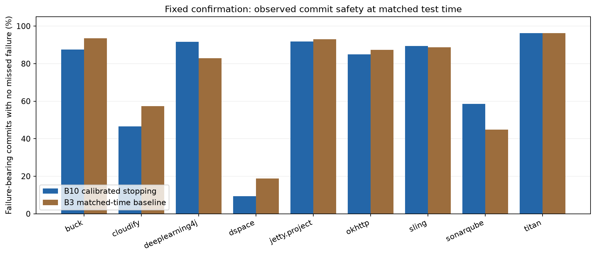
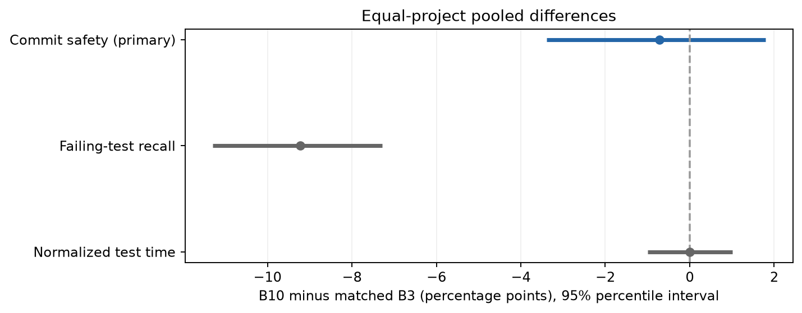

# Nine-project confirmatory results — 2026-10-26

The fixed stopping-rule verdict is **no meaningful difference**. The gate verdict is **gate supported**.

The fixed interval lies within the predeclared safety margin. This study does not support a meaningful safety improvement over matched B3.

## Design and scope

Nine previously uninspected RTPTorrent v1.1 projects were fixed before this confirmation. Each project uses five rolling blocks in the last half of its recorded commits. Models fit only prior history (50/25/25 train/calibrate/audit); the seed is 0 and risk target is 5%. Eligibility requires at least 20 failure-bearing evaluation commits. B3 uses the same ordering with its fixed budget matched to B10's actual test time. This is within-project chronological confirmation, not another cross-project transfer experiment.

Projects supplied: **9**; eligible: **9**; with defined B10/B3 commit safety: **9**.

## Pooled result

| Metric | B10 minus B3 | 95% interval |
|---|---:|---|
| time | 0.000000 | [-0.009900, 0.010100] |
| recall | -0.092200 | [-0.113000, -0.072800] |
| safety | -0.007200 | [-0.033900, 0.017900] |

Differences above use proportions; multiply by 100 for percentage points. Projects receive equal weight. The fixed hierarchical bootstrap uses 2,000 draws and seed 0. The verdict uses the predeclared ±0.05 safety margin and project-count/sign rules.

## Per-project observations

| Project | Evaluation failing commits | Eligible | Accepted blocks | Fit failures | B10 time | B10 safety | B3 safety | Product time | Product miss |
|---|---:|---|---:|---:|---:|---:|---:|---:|---:|
| buck | 169 | True | 0 | 0 | 7.34% | 87.57% | 93.49% | 100.00% | 0.00% |
| cloudify | 148 | True | 0 | 0 | 4.75% | 46.62% | 57.43% | 100.00% | 0.00% |
| deeplearning4j | 205 | True | 1 | 0 | 51.88% | 91.71% | 82.93% | 88.39% | 0.69% |
| dspace | 59 | True | 1 | 1 | 47.36% | 9.38% | 18.75% | 97.63% | 0.11% |
| jetty.project | 86 | True | 0 | 0 | 59.42% | 91.86% | 93.02% | 100.00% | 0.00% |
| okhttp | 238 | True | 3 | 0 | 40.01% | 84.87% | 87.39% | 69.10% | 1.87% |
| sling | 285 | True | 2 | 0 | 59.92% | 89.47% | 88.77% | 91.19% | 0.85% |
| sonarqube | 116 | True | 0 | 0 | 21.10% | 58.62% | 44.83% | 100.00% | 0.00% |
| titan | 53 | True | 1 | 0 | 77.12% | 96.23% | 96.23% | 96.72% | 0.52% |

Time is a fraction of recorded full-suite test duration; it excludes compilation, CI startup and feature extraction. Product means the existing gate chooses B10 on accepted blocks and the full suite otherwise. Safety is conditional on failure-bearing commits; product miss rate uses all evaluation commits.

## Gate evidence

| Blocks | Accepted | Rejected |
|---|---:|---:|
| Number of blocks | 8 | 36 |
| Evaluation commits | 1270 | 6492 |
| Observed B10 miss rate | 2.52% | 3.65% |
| One-sided 95% Wilson upper bound | 3.35% | 4.05% |

The gate verdict follows the fixed observed-rate rules. It is not proof of a calibrated future probability; accepted blocks are observational subsets, not a randomized comparison. An unexercised gate supplies insufficient evidence. Rejected blocks fall back to the full suite in the product.

## Limitations and claim boundaries

- Bootstrap commit resampling ignores serial dependence; intervals are indicative and have no multiplicity correction.
- Recorded CI test-class outcomes can include flaky failures and reflect older open-source Java projects.
- Input preparation warnings, missing commits, repeated runs and excluded/ineligible projects remain part of the evidence; no project is removed to improve the verdict.
- Matching recorded test time does not establish end-to-end CI speedup.
- The source-only transfer failure remains a separate finding. Missing or unvalidated target history still requires the full-suite fallback.
- The Windows repair changes Git transport/error reporting, not the fixed feature, model, calibration, gate or statistical rules. Three completed inputs were reused with verified hashes and preserved parent provenance.

## Reproducibility

Python: `3.12.14`. Packages: `{"numpy": "2.5.4", "scikit-learn": "1.9.1"}`.

Saved study: `../experiments/results/rolling-evidence-confirmatory-windowsfix-2026-10-26/`. Original result manifest SHA-256: `62ce4048df915b58b098061391cfce719e197b17e2bf4734918d2f7cc6424c14`.

Every original output checksum was checked before rendering. The original reports/manifest are untouched. Export/source provenance is stored separately under the study's `audit/` folder. This report renders saved results and does not refit models.

