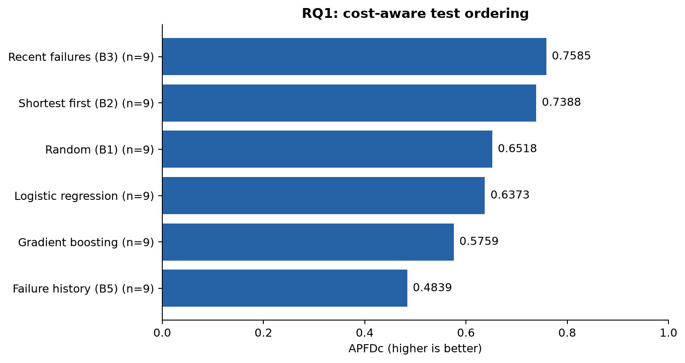
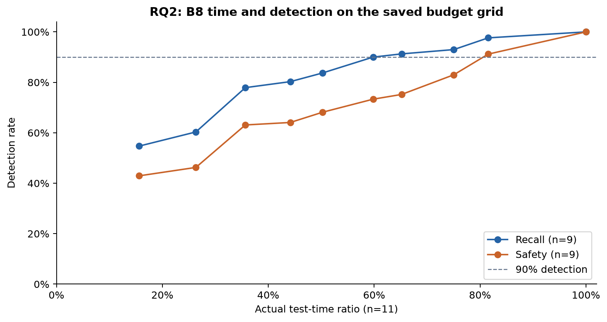
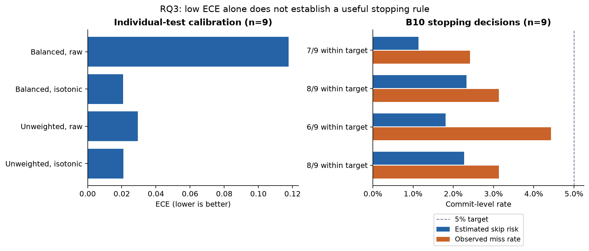
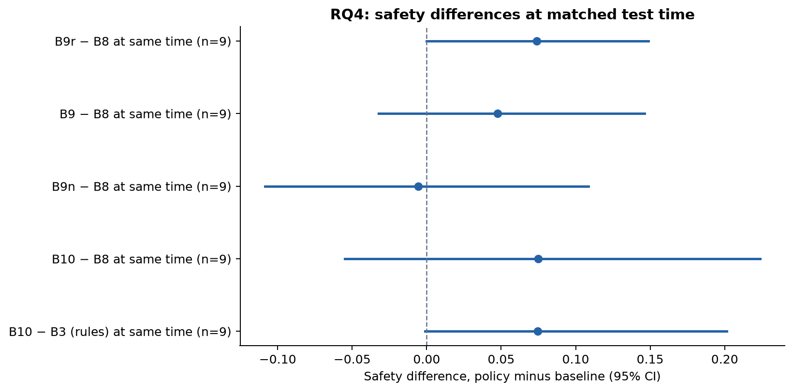
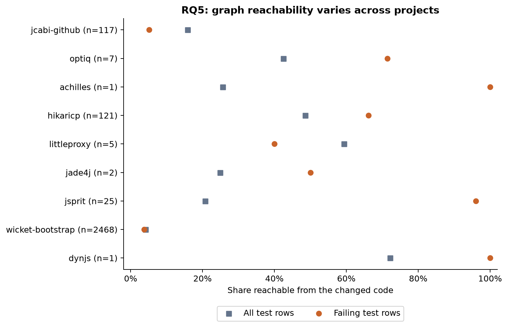

# CodeDNA: assembled FYP report

Working report assembled 2026-10-27. Supervisor review, university formatting,
independent human graph labels and final acceptance evidence remain open.
Research findings are preserved, including negative and inconclusive results.

## Reading guide

- [Abstract](REPORT_ABSTRACT.md)
- [System, design and implementation](REPORT_SYSTEM_DRAFT.md)
- [Evaluation](REPORT_DRAFT.md)
- [Agent brake](REPORT_AGENT_BRAKE.md)

---

# Part: Abstract

# Abstract

CodeDNA investigates how developers can reduce regression testing while making
the limits of test selection explicit. It combines change-impact analysis,
language plugins, historical failure prediction and calibrated stopping with a
target-project audit and full-suite fallback. A desktop IDE, local API and MCP
interface expose the same core analysis. An agent-facing brake combines the
statistical recommendation with dependency-based required tests and project
policy. Java and Python analysis are implemented; validated risk selection is
currently limited to Java.

A nine-project rolling-origin confirmation found no meaningful safety difference
between the B10 stopping rule and recent-failure selection at matched recorded
test time, and lower failing-test recall. The audit gate permits reduced testing
only in a minority of blocks. Failure-conditional conformal stopping, available
as an opt-in method, reaches 95% commit safety on eight of nine follow-up
projects but decreases average safety relative to the conservative gated
product. Cloudify misses the target. Exploratory threshold tuning is promising
but does not establish a superior default. A public agent-patch study evaluates
structural selection, rather than claiming improvements to agents themselves.

The contribution is an implemented, inspectable decision pipeline and a
reproducible evaluation of its tradeoffs. Results do not establish universal
model transfer, future safety guarantees or CI wall-clock speedup. Limitations
include temporal dependence, incomplete CI records, unobserved skipped outcomes,
restricted build support and statistical assumptions under distribution shift.

---

# Part: System, design and implementation

# CodeDNA: system chapters (draft)

Draft of the report chapters other than the evaluation (which is in
[REPORT_DRAFT.md](REPORT_DRAFT.md)): introduction, background, requirements,
design, implementation, testing, limitations and future work. Every claim
points to a decision record (`D-0xx` in [DECISIONS.md](DECISIONS.md)), a
source file or a saved result. Draft originated 2026-10-25; implementation status reconciled 2026-10-27.
Independent labels, clean-PC acceptance and supervisor review remain unverified.

## 1. Introduction

### 1.1 Problem

Continuous integration runs the regression suite on every change. On large
projects the full suite takes long enough that developers wait, batch their
changes or skip tests. Running only some tests is faster, but a skipped test
may be exactly the one that would have failed. Developers therefore need two
answers for each change: *which* tests the change is likely to affect, and
*how risky* it is to skip the others.

Most research answers the first question: it ranks or selects tests from
dependencies, coverage or failure history [2, 24]. Industrial predictive test
selection answers part of the second with an *aggregate* target, such as
"catch 95 % of failing tests across past changes" [9, 11, 12]. What is
rarely given is a risk number for *this* change, used only after the
project's own recent history shows that stopping on it keeps its target,
with the full suite recommended otherwise.

### 1.2 Aim

CodeDNA analyses Java code changes in a Git repository, explains their
impact through a labelled dependency graph, selects regression tests, and
estimates the probability that a skipped test would have failed. When that
estimate has not been validated on the project's own history, CodeDNA says so
and recommends the full suite.

### 1.3 Objectives

1. Extract changed files, declarations and line ranges between two commits
   without running project code (D-003, D-008, D-009).
2. Build a type-level dependency graph whose edges are labelled
   confirmed / heuristic, with unresolved names recorded rather than guessed
   (D-010).
3. Compute the change impact with explanation paths and candidate tests
   (D-012).
4. Map tests to code by dependency and by per-test coverage, and compare
   selection strategies against real outcomes (D-014 to D-016).
5. Learn failure probabilities from the project's test history without
   leakage from future commits, calibrate them and turn them into a stopping
   rule with an omitted-failure risk target (D-023, D-025 to D-027, D-036).
6. Evaluate the approach against established baselines at equal test time on
   real CI data (RTPTorrent), and report where it fails
   ([REPORT_DRAFT.md](REPORT_DRAFT.md)).
7. Deliver it as a usable platform: a CLI, a loopback API, the CodeDNA IDE
   built on Eclipse Theia, and a plugin interface for further languages
   (D-017 to D-020).

### 1.4 Contribution and its limits

Changed-file detection, dependency graphs, affected-test selection, learned
prioritisation, history-based ranking, probability calibration and
recall-target cutoffs are all established, and CodeDNA claims novelty for
none of them. Predictive Test Selection at Facebook [9] already combines a
learned model, a holdout and a recall target. The contribution this project
evaluates is a narrower combination:

- a **per-commit estimate of omitted-failure risk** (the probability that at
  least one skipped test fails), computed from calibrated per-test
  probabilities and used as the stopping rule on top of a simple history
  ordering (policy B10, D-036). Simple rules choose *which* tests run; the
  model chooses only *how many*;
- a **per-project validation gate** (D-041) that accepts the stopping rule
  only when, replayed on the project's recent audit history, it kept the
  miss target (one-sided 95 % Wilson upper bound on the commit miss rate at
  or below the target, at least ten failing commits, at least 90 %
  failing-test recall), and otherwise recommends the full suite with a
  reason. This is an outcome check of the target, not a calibration test of
  each estimate;
- an **open, matched-time evaluation** on public CI data that reports where
  the approach does not help, and an implementation that keeps unverified
  relationships and missing outcomes visible.

The evaluation chapter finds that the per-commit estimate is usable (with a
5 % target the observed miss rate stays within the target on ten of eleven
projects; pooled estimate 2.6 %, observed 2.8 %) but that stopping on it does not catch more failures than a well-chosen
fixed budget at the same test time: the exploratory rolling-origin
difference is −0.003 [−0.036, 0.029] in safety. The value claimed is
therefore a stated risk target that is used only where it held on the
project's recent history, and a safe refusal elsewhere, not a faster or
safer selection. Models trained on one project do not reliably transfer to
another (D-039).

### 1.5 Report structure

Chapter 2 places CodeDNA among related work. Chapter 3 lists the
requirements. Chapter 4 describes the design and chapter 5 the
implementation. Chapter 6 explains how the software was tested. The
evaluation chapter follows ([REPORT_DRAFT.md](REPORT_DRAFT.md)), and chapter 7
closes with limitations and future work.

## 2. Background and related work

### 2.1 Regression test selection and prioritisation

Regression test selection (RTS) runs a subset of tests that may be affected
by a change; test case prioritisation (TCP) orders tests so failures are
found early; minimisation removes redundant tests [1, 2]. Static RTS follows
dependencies from changed code to tests [4]; dynamic RTS uses dependencies
recorded on an earlier run [3]. Both aim to be *safe*: never skip a test
whose outcome could change. CodeDNA implements both as baselines:
`dependency` selection from the graph and `coverage` selection from per-test
JaCoCo maps (D-015, D-016). Section 4.5 of the evaluation shows why safe
selection alone is not enough on this data: on two projects the graph
reaches almost none of the failing tests.

### 2.2 History-based and learned approaches in CI

In continuous integration, dependency analysis is often too slow or too
coarse, so selection uses test history instead. Elbaum et al. select tests
that failed recently or have not run for a while [5]. RETECS learns
prioritisation by reinforcement learning [6]. Bertolino et al. compare
learning-to-rank with ranking-to-learn on CI data [7], and Yaraghi et al.
build a 150-feature model over 25 Java projects [25]. A systematic review
lists dozens of ML-based selection and prioritisation methods [24]. A
recurring finding, which CodeDNA's evaluation repeats, is that simple
history rules are hard to beat once test duration is counted [7, 15].
CodeDNA's study models use 19 features in four groups (change, test,
structural, history; [REPORT_DRAFT.md](REPORT_DRAFT.md) section 2.2) and are
compared against random, shortest-first and history orderings (B1, B2, B3,
B5). The study data is RTPTorrent [8].

### 2.3 Predictive test selection with a target

Predictive Test Selection at Facebook [9] scores each test with a gradient
boosted model trained on past outcomes. It selects tests above a score cutoff
plus the top N, and tunes both cutoffs on a one-week holdout so that over
95 % of failing tests and over 99.9 % of faulty changes are still caught.
Each weekly model is deployed only if it keeps the selection rate under 0.3
at 90 % recall. A 2025 replication on 12 open-source Java projects confirms
the main findings but again analyses no calibration [10]. Two commercial
tools follow the same idea. Launchable's "confidence curve" is the share of
past failing sessions that a given runtime would have caught [11].
Develocity offers Conservative, Standard and Fast profiles "calibrated to
catch over 99 %" of failures, and always runs new, changed, recently failed
and flaky tests [12].

These targets are *aggregate*: they promise a catch rate over many past
changes, not a risk for the current one, and the per-test scores are not
checked as probabilities. CodeDNA differs in two narrow ways. It reports an
estimated omitted-failure risk for each change, and it uses that estimate as
a stopping rule only after a replay on the target project's recent history
kept the miss target (D-041). Its
must-run policy (D-050) plays the same role as Develocity's always-run rules.

### 2.4 Recent research closest to CodeDNA

A property-by-property comparison is kept in
[RELATED_WORK_COMPARISON.md](RELATED_WORK_COMPARISON.md). In summary:

- **Context-Aware Sequential Ranking** [13] uses the same RTPTorrent data.
  It fuses history and code-semantic scores, builds class-conditional
  conformal candidate sets (α = 0.10, with an adaptive update) and stops at a
  cost budget of 10, 25 or 50 % of the suite. Its conformal layer reorders
  tests and reports candidate coverage (0.906); it does not estimate the
  probability of missing a failure among skipped tests, and no per-project
  acceptance step was found. It also finds that history alone is close to
  its best model (0.869 against 0.884).
- **MOX** [14] optimises cost, impact, coverage and traceability on a Pareto
  front under a residual impact budget θ. The authors state that the budget
  is "not an empirically calibrated safety guarantee", and change events in
  their data are inferred from failures.
- **DANTE** [15] is a training-free history and commit-aware method that
  beats ML baselines on long-running Java suites. It is the strongest
  baseline found. CodeDNA evaluates an independently implemented,
  history-only adaptation (DANTE-H, D-040), not the full published method.
  Only DANTE's abstract was available; whether it has a stopping rule is
  unverified.
- **AutoTCP** [16] composes and tunes prioritisation workflows per build by
  grammar-guided genetic programming; it ranks tests and gives no skip risk.
- **Risk-aware batch testing** at Mozilla [17] predicts a regression
  probability per commit and flushes a batch when the probability that it
  holds a regressor passes a threshold, using the same independence
  assumption as CodeDNA's skip risk. Its scores are not calibrated.
- **Continuous test suite failure prediction** [18] predicts whether a whole
  suite run will fail, so that runs can be skipped.

### 2.5 Calibration and uncertainty

A predicted probability is calibrated when, among tests given probability p,
a fraction p actually fail. Platt scaling and isotonic regression are the
standard post-hoc methods [20]; conformal prediction gives distribution-free
coverage sets instead of probabilities [23], and conformal risk control
extends this to bounding the expected value of any monotone loss [26]. One
open-source project applies conformal risk control to the share of missed
failing tests on an industrial dataset [27]. In software engineering,
just-in-time defect predictors were found miscalibrated (ECE 7–35 %), and
post-hoc calibration did not consistently help [19]. CodeDNA fits Platt or
isotonic calibration on a held-out window and reports Brier score, expected
calibration error and reliability bins (D-025). Its evaluation shows a large
ECE drop (0.118 to 0.021), but also that much of the gain only undoes
balanced class weighting (D-037; [REPORT_DRAFT.md](REPORT_DRAFT.md)
section 4.3). The finding that matters is a different one: a model with a
low ECE can still underestimate the *summed* risk of many skipped tests, and
without calibration the stopping rule broke its target on a third of the
projects. Calibration is therefore presented as a requirement of a
risk-target stopping rule, not as an accuracy gain.

### 2.6 Test selection for AI coding agents

Coding agents now open many pull requests, and failing tests are a leading
reason they are rejected. TDAD [21] gives an agent a static code-to-test map
before it commits and reports fewer regressions on SWE-bench Verified
(6.08 % to 1.82 %, on 100 and 25 tasks). TestPrune [22] minimises the
existing regression suite so an agent can use it for reproduction and
validation. Neither states a risk for the tests left out. CodeDNA's brake
(D-059) exposes the same risk estimate and gate to agents; this report makes
no claim that it improves agents, because no paid agent runs were made.

### 2.7 Position

CodeDNA sits between safe RTS, which never skips a possibly affected test,
and predictive selection, which skips tests to meet an aggregate target. A
re-implementation of the Predictive Test Selection rule (evaluation section
4.9) neither beats nor loses to CodeDNA's stopping rule at the same test
time on four projects, but its aggregate targets held less often out of
sample. It
keeps a simple history ordering, adds a per-change risk estimate that must
pass a per-project outcome check, and falls back to the full suite when it does not.
The report never claims to be the first to do this, and section 4 shows that
the approach buys a risk target that has been shown to hold on the
project, rather than extra failures caught.

## 3. Requirements

### 3.1 Functional requirements

| ID | Requirement | Where |
|---|---|---|
| F1 | Report changed files, statuses, renames and line ranges between two revisions, including uncommitted changes (`WORKTREE`) | `git_analysis`, D-046 |
| F2 | Map changed lines to Java declarations; mark comment-only changes; record unmapped lines with a reason | `java_analysis`, D-008, D-009 |
| F3 | Build a dependency graph with confirmed / heuristic edges, evidence and unresolved names | `dependency_graph`, D-010 |
| F4 | Compute impacted types with distance, confidence and explanation path | `impact_analysis`, D-012 |
| F5 | Discover JUnit 3/4/5 test classes the build runs by default, for single and multi-module Maven and Gradle projects | `test_mapping`, D-045, D-052, D-064 |
| F6 | Select tests by strategy (all, dependency, coverage, risk) and compare strategies against real outcomes | `selection`, D-016 |
| F7 | Never skip tests the project marks as must-run | `selection/policy.py`, D-050 |
| F8 | Store commit history and test outcomes; build leakage-free feature rows | `test_history`, D-021 to D-023 |
| F9 | Train, calibrate and evaluate failure models; run the study policies B0 to B10 | `models`, `calibration`, D-022, D-025 to D-027, D-034 to D-037 |
| F10 | Give a live risk recommendation only after a target-project audit, otherwise the full suite | `selection/live.py`, `codedna_java/live.py` (plugin), D-041 |
| F11 | Run the selected tests only after explicit consent, and keep complete runs as project history | `test_mapping/maven.py`, D-014, D-053 |
| F12 | Show changes, impact graph, tests to run with risk, and history replay in an IDE | `ide/`, D-019, D-043, D-049, D-051 |
| F13 | Accept further languages as plugins behind a fixed interface | `plugins/`, D-018, D-024 |

### 3.2 Non-functional requirements

- **Honesty of output.** No invented dependency, outcome or number; unknown
  results are recorded as unknown (AGENTS.md; D-010, D-041).
- **Safety of analysis.** Analysis never executes code from the analysed
  repository. Git is called with argument lists only, with settings that stop
  repository-local helpers from running. Tests run only with an explicit
  `--allow-build` or IDE confirmation (D-014).
- **Reproducibility.** Fixed seeds, chronological splits, recorded dataset
  hashes and package versions in every experiment report (D-027, D-038).
- **Laptop scale.** Runs on an ordinary Windows, macOS or Linux laptop; no
  GPU, cluster or service.
- **Local only.** The API listens on 127.0.0.1 with a per-session token; there
  are no accounts (D-028).
- **Testability.** Every feature has offline tests on temporary Git
  repositories.

### 3.3 Out of scope

Vulnerability detection and security scoring, an LLM as the predictor,
hosted multi-user services, a custom editor written from scratch, and
installing plugins from anywhere but the official catalogue
([PROJECT_SPEC.md](PROJECT_SPEC.md), "Non-goals"). Security checks are planned
as future work through the policy hook (section 7.2).

## 4. Design

### 4.1 Pipeline

CodeDNA is a pipeline in which each stage consumes the previous stage's JSON
([ARCHITECTURE.md](ARCHITECTURE.md)):

```
Git change extractor → Java declaration mapper → dependency graph →
change impact → candidate tests → history features → failure model →
calibration → risk-aware selection (or full suite) → execution → explanation
```

The IDE and the website only display this JSON. No analysis logic exists in
TypeScript, so the same result is available from the CLI, the API and the
IDE.

### 4.2 Platform structure (D-017, D-018)

- **Core** (Python): Git access, graph schema, impact, selection, history,
  models, calibration, policy, API.
- **Language plugins**: language-specific parsing, test discovery, test
  execution and live features sit behind the `LanguagePlugin` protocol with a
  versioned API (`PLUGIN_API_VERSION`). Java is built in; other plugins are
  found through the `codedna.languages` entry-point group. A plugin with the
  wrong API version or a broken import is skipped and reported, not loaded
  half-way (D-024).
- **IDE**: a Theia application with a CodeDNA extension that talks to the
  local API (D-019).
- **Website and catalogue**: static pages and a catalogue index that pins
  plugin versions and SHA-256 checksums (D-020, D-047).

### 4.3 Graph model and confidence labels (D-010)

Nodes are packages, files, types and members. Edges are `contains`,
`extends`, `implements`, `uses`, `imports` and `static_access`, each with a
confidence:

- **confirmed** when the name resolves unambiguously (same package, explicit
  import, nested type);
- **heuristic** when resolution depends on an assumption, such as a wildcard
  import or a capitalised receiver read as a type;
- names that cannot be resolved become **unresolved** entries with a reason
  and never become edges.

Impact follows edges backwards from changed types; an impacted type is
confirmed only if every edge on its path is. This keeps the explanation
honest: the user sees which links CodeDNA is sure about.

### 4.4 Learning and risk design

Rows are (commit, test class) pairs. Features of a commit use only outcomes
of earlier commits (D-023). The study uses a fixed chronological split; the
live predictor uses 15 features available for a new change and a separate
50/25/25 fit / calibrate / audit split of the project's own history (D-041).

The skip risk of a selection is the probability that at least one skipped
test fails, computed from calibrated per-test probabilities as
`1 − Π(1 − p)`, which assumes independent failures (D-026). B10
orders tests by a simple history rule and stops adding tests once that risk
falls below the target (D-036).

The live gate accepts a recommendation only if the audit window shows a
one-sided 95 % Wilson upper bound on the miss rate at or below the target, at
least ten failure-bearing audit commits and at least 90 % failure recall
(`selection/validation.py`). It also checks that the history belongs to the
target branch, is chronological, ends at BASE, covers every current test
class and excludes the requested change. Any failed check gives the full
suite and a reason.

### 4.5 Must-run policy (D-050)

`.codedna/policy.toml` lists tests that may never be skipped. It is read
from the BASE commit, so a change cannot weaken its own checks. A malformed
policy or a failing add-on rule pins every test (fail-safe). Add-on rules
plug in through the `codedna.policies` entry-point group, which is the
intended hook for later security checks. Research comparisons ignore the
policy so study numbers are unaffected.

### 4.6 Building history while in use (D-053)

Because the gate needs complete outcomes and public CI records are
incomplete (D-052), every run of the whole suite that CodeDNA starts is kept
as project history. Only complete runs at commits on the current branch are
recorded, and a history file CodeDNA did not write is never overwritten. The
gate itself is not loosened.

### 4.7 Security of the local tool

The tool analyses untrusted repositories, so its design limits what a
repository can make it do (this is engineering hygiene, not a security
feature of the product):

- Git runs without a shell, with external diff and text-conversion drivers
  disabled and `core.fsmonitor=false`.
- Working-tree snapshots refuse repositories that use filter drivers such as
  Git LFS, because `git add` would run the driver.
- The runner exports a commit with `git archive` into a separate folder and
  runs the build only after consent.
- The API checks a token and the `Host` header and listens only on loopback.

## 5. Implementation

### 5.1 Technology choices

| Part | Choice | Reason |
|---|---|---|
| Core language | Python 3.11+ | Data and ML libraries; quick to test (D-001) |
| Java parsing | Tree-sitter Java | Error-tolerant, no JDK needed, exact line extents (D-008, D-033) |
| Storage | SQLite | One file per project, no server (D-021) |
| Models | scikit-learn logistic regression and gradient boosting | Standard, laptop-friendly (D-022) |
| API | FastAPI on 127.0.0.1 | Typed requests, same JSON as the CLI (D-028) |
| IDE | Eclipse Theia + TypeScript extension, Cytoscape graph | Full editor without writing one (D-019, D-029, D-043) |
| Packaging | Electron app with an NSIS installer for Windows | Ordinary desktop install (D-044) |

### 5.2 Core modules

- `git_analysis`: safe Git calls, change extraction, blob readers,
  working-tree snapshots (D-046).
- `codedna_java`: Tree-sitter parse and line-to-declaration mapping (separate plugin, D-054).
- `dependency_graph`: one `git cat-file --batch` read per commit, parse cache
  by blob SHA, reference resolution with evidence.
- `impact_analysis`: merged BASE/HEAD graph, reverse BFS, explanation graph
  with package grouping and summary counts (D-051).
- `test_mapping`: shared test-result and coverage schemas. `codedna_java`
  supplies Maven/Gradle layout detection, test discovery, execution and Maven
  per-test JaCoCo coverage. `codedna_python` supplies AST analysis, static pytest
  module discovery and execution through the same core plugin interface.
- `selection`: strategies, comparison, risk decision, policy, live gate.
- `test_history`, `models`, `calibration`: history store, dataset builder,
  rankers, experiment runner, calibrators and metrics; `recording.py` keeps
  full-suite runs (D-053).
- `api`: FastAPI endpoints mirroring the CLI, with build permission needed
  both at server start and per request.

### 5.3 CodeDNA IDE

The extension adds these views to Theia:

- **Changes**: changed files and declarations for "my last commit", a chosen
  range or uncommitted changes.
- **Impact graph**: one lane per package, columns by distance from the
  change, changed code outlined, controls for depth and confirmed links only
  (D-051). The layout was checked by rendering real HikariCP graphs in
  headless Chromium; Cytoscape's force layout with package boxes overlapped
  and was rejected.
- **Tests to run**: the recommendation with risk status, audit evidence and
  reasons for each test; a confirmed run of the selected tests with real
  statuses and logs; whether the run was kept as history (D-041, D-053).
- **History replay**: the study's test commits played back one by one,
  CodeDNA against run-everything, dependency selection and simple rules,
  with running totals checked against the saved reports (D-049).
- Java editing support and progress notifications (D-044).

### 5.4 Real-project demonstration (D-052)

`scripts/make_hikaricp_demo.py` builds a HikariCP working copy at a real
tested change (dd7c9a9a) with the project's recorded history up to BASE, and
writes CodeDNA's answers next to the real CI outcome from RTPTorrent. On
that change 17 of 21 test classes failed in CI; dependency selection picked
19 of 21 classes and caught all 17 in 24 % of the CI test time. The risk view
honestly stays unvalidated on this history (section 4.8 of the evaluation).
The commit was picked for the demonstration and is not evidence.

## 6. Testing and verification

### 6.1 Automated tests

The pytest suite builds temporary Git repositories for every scenario; the
default run needs no network. The Maven integration tests (`--run-maven`)
also need a JDK, Maven and network access while Maven downloads its plugins
and JUnit. Areas covered include renames, CRLF files, syntax errors,
binary files, multi-module and Gradle layouts, graph resolution and labels,
impact paths, selection strategies, history leakage, calibration, the live
gate's refusal cases, the must-run policy, recording, the API's token and
`Host` checks, and the IDE start script on Windows.

A fake `mvn` script (`backend/tests/fake_mvn.py`) writes Surefire and JaCoCo
files so runner logic is tested without Java. One integration test runs the
real Maven build of `examples/sample-java-project` with JaCoCo; the project
rule is that it must not be silently skipped (`--run-maven`).

Latest full local run (2026-10-25, Linux, Python 3.13, Maven included):
`python -m pytest --run-maven` → 329 passed, 4 skipped. The skipped tests
are the Windows-only `start.bat` checks.

### 6.2 Continuous integration

GitHub Actions (`.github/workflows/ci.yml`) runs on every pull request:

- the Python suite on Ubuntu and Windows with Python 3.11 and 3.12, plus a
  CLI smoke test;
- the sample Java project with Maven and JUnit 5;
- the IDE extension type-check and compile;
- CodeDNA with real Maven and JaCoCo (integration).

### 6.3 Manual checks

- IDE build and start on the Windows laptop (PR #10, #11). The installer
  build depends on native modules and Visual Studio Build Tools; its status
  is recorded in [IMPLEMENTATION_HANDOFF.md](IMPLEMENTATION_HANDOFF.md).
- Impact graph layout rendered on real HikariCP graphs (D-051).
- Test discovery on HikariCP 688d1911 matches the 21 classes CI ran (D-052).
- **Graph precision check (D-058).** 160 dependency edges were sampled with
  a fixed seed, 40 confirmed and 40 heuristic from each of HikariCP and
  LittleProxy, and checked against the source. All 160 were correct:
  precision 1.00, with a 95 % Wilson interval of [0.954, 1.00] for each label.
  Every unresolved name was also sorted into groups to look for missed links.
  This found four causes: `var` read as a type name, an incomplete
  `java.lang` list, member types brought in by static imports, and member
  types inherited from a superclass. One of these had silently resolved an
  inherited `Override` enum to the JDK annotation. After the fixes, the
  unresolved rate fell from 0.264 to 0.139 on HikariCP and from 0.103 to
  0.070 on LittleProxy, and no remaining unresolved name is a type the graph
  models. The labels were made by Claude while reading the source and still
  need a spot check by a student
  (`experiments/results/graph-precision-2026-10-25/FINDINGS.md`).

## 7. Limitations and future work

### 7.1 Limitations

- **Java-specific risk evidence.** Java and Python plugins exist. Python/mixed
  projects use full-suite risk fallback; Java-trained risk does not transfer
  to Python. Additional languages and cross-language edges are not implemented.
- **Type-level graph.** Calls between methods are not resolved, so impact is
  coarser than the change.
- **Class-level outcomes.** History and selection work per test class, not
  per test method.
- **Evidence needs time.** The live gate needs many recorded commits with
  failures before it trusts the risk estimate; on public CI histories it never
  accepted, because the records were incomplete (D-052). Until then the
  product recommends the full suite, which is safe but saves no time.
- **No transfer.** Models trained on one project are not reliable on another
  (D-039).
- **Data age.** The study projects are open-source Java projects from 2007 to
  2016 on Travis CI; modern or industrial CI may behave differently.
- **Confirmatory limits.** The nine-project confirmation and four follow-ups
  are complete (evaluation sections 4.11/4.12, D-067/D-069). They do not establish
  B10 superiority or a universally safe replacement default. A missing pre-run
  addendum cannot be repaired retrospectively.

### 7.2 Future work

The Java package split, plugin manager, Python plugin and agent-facing brake
are implemented (D-054/D-060/D-068/D-070), rather than future proposals. The
live brake offers failure-conditional conformal stopping as opt-in CRC; B10
remains default because the follow-up results do not justify replacing it.

- Complete clean-machine acceptance, independent student graph labels and
  university supervisor review. Local automation does not replace these checks.
- Publish an approved public catalogue and verified release files while keeping
  the source private; validate optional installation in the frozen desktop.
- Evaluate policy-specific observed history and scheduled full-suite audits in
  a separate, pre-specified deployment-faithful study. Existing reports use the
  available historical outcomes and do not establish performance under censored
  feedback from selected-only execution.
- Resolve method-level call edges, retain honest confidence labels, and evaluate
  additional languages separately before enabling their statistical stopping.
- Study temporally dependent failures and risk under changing distributions.
  Any changed default needs new held-out evidence, not favorable retuning of
  completed confirmatory results.

## References

1. G. Rothermel and M. J. Harrold. Analyzing regression test selection
   techniques. *IEEE Transactions on Software Engineering* 22(8), 1996.
2. S. Yoo and M. Harman. Regression testing minimization, selection and
   prioritization: a survey. *Software Testing, Verification and
   Reliability* 22(2), 2012.
3. M. Gligoric, L. Eloussi and D. Marinov. Practical regression test
   selection with dynamic file dependencies. *ISSTA* 2015.
4. O. Legunsen, F. Hariri, A. Shi, Y. Lu, L. Zhang and D. Marinov. An
   extensive study of static regression test selection in modern software
   evolution. *FSE* 2016.
5. S. Elbaum, G. Rothermel and J. Penix. Techniques for improving regression
   testing in continuous integration development environments. *FSE* 2014.
6. H. Spieker, A. Gotlieb, D. Marijan and M. Mossige. Reinforcement learning
   for automatic test case prioritization and selection in continuous
   integration. *ISSTA* 2017.
7. A. Bertolino, A. Guerriero, B. Miranda, R. Pietrantuono and S. Russo.
   Learning-to-rank vs ranking-to-learn: strategies for regression testing
   in continuous integration. *ICSE* 2020.
8. T. Mattis, P. Rein, F. Dürsch and R. Hirschfeld. RTPTorrent: an
   open-source dataset for evaluating regression test prioritization.
   *MSR* 2020.
9. M. Machalica, A. Samylkin, M. Porth and S. Chandra. Predictive test
   selection. *ICSE-SEIP* 2019. arXiv:1810.05286.
10. S. Aichmann. *Predictive Test Selection: A Replication Study*. Diploma
    thesis, TU Wien, 2025.
11. Launchable. How a confidence curve is generated. Product documentation,
    accessed 2026-10-25.
12. Gradle Develocity. Predictive Test Selection user manual (2026.3).
    Product documentation, accessed 2026-10-25.
13. U. Altınışık. Context-aware sequential ranking for dynamic test case
    prioritization in continuous integration. *Mathematics* 14(18):3276,
    2026.
14. M. Bădoi, A. Bărcan, A. Vultureanu-Albiși and N. Țăpuș. Multi-objective
    explainable AI for risk-aware test selection in multi-layer continuous
    integration systems. *Electronics* 15(17):3854, 2026.
15. S. Reale, E. Di Nitto, L. Baresi, M. Di Penta and G. Quattrocchi. DANTE:
    data-driven test case selection and prioritization for long-running test
    suites. *ICST* 2026, pp. 5–16.
16. J. R. Romero, A. Ramírez and C. García-Martínez. Automated machine
    learning for test case prioritisation. *Empirical Software Engineering*
    31:120, 2026.
17. A. Sayedsalehi, P. C. Rigby and G. Mierzwinski. Risk-aware batch testing
    for performance regression detection. arXiv:2604.00222, 2026.
18. C. Pan and M. Pradel. Continuous test suite failure prediction. *ISSTA*
    2021.
19. X. Shahini, J. Bartel and K. Pohl. On the calibration of just-in-time
    defect prediction. *MSR* 2025.
20. A. Niculescu-Mizil and R. Caruana. Predicting good probabilities with
    supervised learning. *ICML* 2005.
21. P. Alonso, S. Yovine and V. A. Braberman. TDAD: test-driven agentic
    development. Reducing code regressions in AI coding agents via
    graph-based impact analysis. arXiv:2603.17973, 2026.
22. Y. Chen, T. Ahmed, R. Jabbarvand and M. Hirzel. Can old tests do new
    tricks for resolving SWE issues? arXiv:2510.18270, 2025.
23. A. N. Angelopoulos and S. Bates. Conformal prediction: a gentle
    introduction. *Foundations and Trends in Machine Learning* 16(4), 2023.
24. R. Pan, M. Bagherzadeh, T. A. Ghaleb and L. Briand. Test case selection
    and prioritization using machine learning: a systematic literature
    review. *Empirical Software Engineering* 27, 2022.
25. A. S. Yaraghi, M. Bagherzadeh, N. Kahani and L. Briand. Scalable and
    accurate test case prioritization in continuous integration contexts.
    *IEEE Transactions on Software Engineering* 49(4), 2023.
26. A. N. Angelopoulos, S. Bates, A. Fisch, L. Lei and T. Schuster.
    Conformal risk control. *ICLR* 2024.
27. l-k-1-2. Predictive-test-selection: conformal risk control on the
    Enhanced Westermo dataset. GitHub repository, accessed 2026-10-26.

---

# Part: Evaluation

# CodeDNA: evaluation chapter (draft)

Draft of the methods, results and threats-to-validity chapters for the FYP
report (the other chapters are in [REPORT_SYSTEM_DRAFT.md](REPORT_SYSTEM_DRAFT.md)), covering research questions RQ1 to RQ5 (docs/RESEARCH_PLAN.md).
Every number comes from files under `experiments/results/`; the source of
each table is named. Status: evaluation draft with reproducible figures, 2026-10-24.

## 1. Research questions

- **RQ1.** How accurately do structural, change and historical features
  predict regression-test failures?
- **RQ2.** How much test execution time can be saved at given empirical
  failure-detection targets?
- **RQ3.** Does probability calibration improve the reliability of
  test-risk estimates?
- **RQ4.** Does uncertainty-aware fallback improve the safety/cost
  trade-off?
- **RQ5.** Do graph-derived features improve prediction enough to justify
  their cost?

## 2. Method

### 2.1 Data

We use RTPTorrent v1.1 (Mattis, Rein, Dürsch and Hirschfeld, MSR 2020;
Zenodo record 4046180, CC BY 4.0; archive md5
`1f7fa822b0cf155bd007a94d1a24a336`). It holds Travis CI test results at
test-class level for 20 open-source Java projects (2007 to 2016), the links
from CI jobs to Git commits, and the projects' Git repositories. Using
recorded CI outcomes means no third-party code is built or executed.

`codedna history import-rtptorrent` imports one project at a time. A CI job
can cover several commits; the tested commit is the single tip of the job's
commits, and its change is measured against the state before the push. A
test class can appear several times in one job (one run per module); those
runs are merged, and the class counts as failed if any run failed. A commit
counts as failing if any of its jobs records a failure (D-021). Eleven
projects were imported; their job counts match Table 2 of the RTPTorrent
paper (docs/DATASET_PLAN.md).

### 2.2 Features

Each (commit, test class) pair becomes one row with 19 features, computed
only from information available before the commit (D-023):

| Group | Features |
|---|---|
| Change (6) | files, Java files, non-Java files and test files changed; lines added and deleted |
| Test (1) | whether the test class itself changed |
| Structural (3) | whether the dependency graph reaches the test from the change, the distance, and whether the path is confirmed |
| History (9) | past runs, past failures, failure rate, failures in the last 5 runs, failed last run, commits since last failure, mean and last duration, co-failures |

The structural features come from CodeDNA's dependency graph: Java files are
parsed with tree-sitter, class-level edges (extends, implements, uses,
imports, static access) are labelled confirmed or heuristic, and impact is a
reverse breadth-first search over the merged before/after graphs.

### 2.3 Split, models and seeds

Commits are split chronologically: oldest 60 % train, next 20 %
validation, latest 20 % test. Nothing is shuffled. Two classifiers are
trained on the training split with scikit-learn: logistic regression and
histogram gradient boosting, both with balanced class weights (the rare
failing rows are up-weighted). Selection experiments use gradient boosting.
A separate check trains the same model without class weights, as a stricter
uncalibrated baseline for RQ3 (D-037). Calibrators (Platt scaling and isotonic
regression) are fitted on the validation split only. Every experiment is run
with five seeds (0 to 4); seeds change model randomness only, not the split.

### 2.4 Orderings and selection policies

Orderings (RQ1): random (B1), shortest first (B2), recent failures then
shortest (B3), failure history (B5), logistic regression and gradient
boosting.

Selection policies (RQ2, RQ4), each applied to every test commit:

| Policy | Rule |
|---|---|
| B0 | run every test |
| B4 | dependency only: tests the graph reaches from the change, plus changed tests |
| B6 | change-only model, 50 % time budget |
| B7 | full model, uncalibrated, 50 % budget |
| B8 | full model, calibrated, 50 % budget |
| B9 | B8 plus risk target 0.05 with fallback, plus the unfamiliar-change rule |
| B9r | B8 plus risk-target fallback only |
| B9n | B8 plus unfamiliar-change rule only (non-Java files changed, or most tests without history, means run everything) |
| B3 | rules order (recent failures, then shortest), 50 % budget |
| B10 | hybrid: rules order, no budget; add tests until the calibrated estimated skip risk is at most 0.05 |

Model-based policies take tests in order of probability per second of
expected run time. The estimated skip risk of a selection is
1 − Π(1 − p) over the skipped tests, which assumes independent failures.

### 2.5 Metrics

- Ordering: APFD and APFDc (cost-aware), failing-test recall at 25 % and
  50 % of test time.
- Prediction: PR-AUC.
- Calibration: Brier score and expected calibration error (ECE, 10
  equal-width bins); per commit, the mean absolute gap between estimated
  skip risk and observed miss rate.
- Selection: test-time ratio (selected test time / full run time),
  failing-test recall, and commit safety (share of failing commits where
  every failing test was selected).

### 2.6 Fair comparison and uncertainty

A policy that runs more tests usually catches more failures. To separate
better decisions from more testing, each policy of interest is compared
with a baseline whose budget is tuned by bisection so that it spends the
same real test time (D-035): B9, B9r, B9n and B10 against B8, and B10 also
against B3.

Point estimates are means over the five seeds. 95 % intervals come from a
hierarchical percentile bootstrap: pick a seed, then resample that seed's
test commits (paired between policy and baseline). Pooled results average
the projects with equal weight, resampling within each project, and report
how many projects contribute (a project without failing test commits has no
recall or safety).

### 2.7 Figure provenance

The five figures are generated from saved reports by
`scripts/make_study_figures.py` (D-038), without retraining or rebuilding the
feature datasets. Their exact values and project cohorts are in
`experiments/results/study11-2026-10-21/figures/figure-data.json`; the adjacent
`manifest.json` fingerprints the input reports, exporter and artifacts.
Raw/calibrated comparisons use common project cohorts. No confidence intervals
are derived from standard deviations over random seeds.

## 3. Data actually available

Source: `experiments/results/study11-2026-10-21/summary.md`.

| Project | Test commits | With failures | Failing rows |
|---|---|---|---|
| graylog2-server | 879 | 0 | 0.0 % |
| jOOQ | 258 | 0 | 0.0 % |
| jcabi-github | 118 | 52 | 0.7 % |
| optiq | 91 | 4 | 0.14 % |
| Achilles | 101 | 1 | 0.01 % |
| HikariCP | 286 | 20 | 2.0 % |
| LittleProxy | 53 | 5 | 0.26 % |
| jade4j | 63 | 2 | 0.12 % |
| jsprit | 52 | 7 | 0.52 % |
| wicket-bootstrap | 164 | 87 | 30.4 % |
| dynjs | 75 | 1 | 0.02 % |

graylog2-server and jOOQ have no failing test commits: their CI logs record
far fewer test classes in the test period (about 1 and 7 per commit), which
we attribute to changes in the projects' CI rather than to the importer
(stored and derived failure counts agree). They contribute to time and
calibration results but not to recall or safety, so those pooled results
use n = 9 projects. Several of the nine have fewer than ten failing test
commits, so per-project results for them are close to anecdotes.

## 4. Results

### 4.1 RQ1: predicting failures

Gradient boosting with all 19 features reaches a pooled PR-AUC of 0.138
(n = 9), far above the failure base rate on most projects (for example
jcabi-github 0.163 against 0.007, optiq 0.357 against 0.0014, HikariCP 0.039
against 0.020, wicket-bootstrap 0.635 against 0.304). The features carry
real signal.

Ablations (pooled PR-AUC; `summary.md`, "Ablations"): all features 0.138,
without history 0.080, without change 0.098, without structural 0.119.
History features matter most. On projects with very few failures the
ablations are unstable (on jade4j the model *without* history scores
0.251 against 0.016 with all features), a sign of overfitting to a handful
of failing rows.

Turning predictions into an *ordering* is a different matter (source:
`summary.md`, "Ordering", n = 9):

| Ordering | APFD | APFDc | Recall at 25 % time | Recall at 50 % time |
|---|---|---|---|---|
| Recent failures, then shortest (B3) | 0.511 | **0.759** | 0.578 | 0.714 |
| Shortest first (B2) | 0.427 | 0.739 | 0.572 | 0.702 |
| Random (B1) | 0.627 | 0.652 | 0.505 | 0.635 |
| Logistic regression | **0.644** | 0.637 | 0.428 | 0.619 |
| Gradient boosting | 0.612 | 0.576 | 0.378 | 0.527 |
| Failure history (B5) | 0.588 | 0.484 | 0.263 | 0.418 |

Logistic regression has the best APFD, which ignores test duration. Once
duration counts (APFDc, recall at a time budget), the time-aware rules win
and both learned models are at or below random. The best ordering by APFDc
is a simple rule on six of the nine projects.



Figure 1. APFDc of the saved orderings; n is the number of projects with a defined metric.

**Answer to RQ1.** The features predict failures well above chance, mainly
through test history. The learned models do not order tests better than
simple time-aware rules on this data.

### 4.2 RQ2: time saved at a detection target

Pooled budget sweep of the calibrated selector B8 (mean over projects of the
mean over seeds; `experiment-seed*.json`, `risk_coverage`):

| Budget | Time | Recall | Safety |
|---|---|---|---|
| 0.3 | 0.36 | 0.78 | 0.63 |
| 0.5 | 0.50 | 0.84 | 0.68 |
| 0.6 | 0.60 | 0.90 | 0.73 |
| 0.8 | 0.75 | 0.93 | 0.83 |
| 0.9 | 0.82 | 0.98 | 0.91 |

To catch 90 % of failing tests the selector needs about 60 % of the full
test time (a 40 % saving); to run every failing test on 90 % of failing
commits it needs about 82 % (an 18 % saving). The hybrid B10 (section 4.4)
reaches recall 0.94 and safety 0.88 at 61 % of the time with a 1 % risk
target, but that pooled comparison is not cost-matched per project and is
driven by wicket-bootstrap.



Figure 2. B8 detection rates against actual mean test time. Time pools eleven projects; recall and safety pool nine. These pooled curves are descriptive, not per-project cost-matched comparisons.

**Answer to RQ2.** Savings of about 40 % are possible at 90 % recall, but
much smaller savings if every failing commit must be fully caught. The
curve is project-specific: wicket-bootstrap only becomes safe above about
80 % of the test time.

### 4.3 RQ3: calibration

| | Uncalibrated | Platt | Isotonic |
|---|---|---|---|
| ECE (pooled) | 0.100 (n = 11) | 0.022 (n = 9) | 0.021 (n = 9) |
| ECE, same 9 projects | 0.118 | 0.022 | 0.021 |
| Brier (pooled) | 0.075 (n = 11) | 0.021 (n = 9) | 0.022 (n = 9) |

Achilles and jsprit have no failures in their validation split, so no
calibrator could be fitted. On the nine others ECE fell on eight and stayed
equal on one (jade4j). At commit level, the mean absolute gap between the
estimated skip risk and the observed miss rate fell from 0.274 (B7,
uncalibrated) to 0.078 (B8, calibrated), improving on 7 of 11 projects and
getting worse on LittleProxy (0.22 to 0.27).

The balanced class weights used for training push raw probabilities up,
so the uncalibrated column above is a weak baseline. Training the same
model without class weights gives a stricter one (`class-weight-summary.md`,
same 9 projects, mean over 5 seeds):

| | Balanced, raw | Balanced, isotonic | Unweighted, raw | Unweighted, isotonic |
|---|---|---|---|---|
| ECE | 0.118 | 0.021 | 0.030 | 0.021 |
| Brier | 0.090 | 0.022 | 0.029 | 0.023 |
| Skip-risk gap, 50 % budget | 0.306 | 0.067 | 0.054 | 0.071 |
| PR-AUC (n = 9) | 0.138 | | 0.103 | |

The unweighted model is already well calibrated. Calibrating it lowers ECE
on 5 of 9 projects and raises it on 4; the clear gains are on the two
projects with the most failures (wicket-bootstrap 0.171 to 0.102, HikariCP
0.020 to 0.013). Its commit-level risk estimate is as close to the observed
miss rate as any calibrated variant. Balanced weights, on the other hand,
rank failures better (PR-AUC 0.138 against 0.103, much of it from optiq,
which has four failing test commits).

The ECE comparison does not show how the probabilities behave in a
decision. The same check therefore ran the hybrid policy B10 (section 4.4:
rules order, stop when the estimated skip risk is at most 0.05) with each
model's raw and isotonic probabilities (`class-weight-summary.md`):

| B10 (target 0.05), same 9 projects | Time | Recall (n = 7) | Safety (n = 7) | Est. risk | Observed miss | Within 5 % |
|---|---|---|---|---|---|---|
| Balanced, isotonic (the study's model) | 0.36 | 0.80 | 0.72 | 0.023 | 0.031 | 8 of 9 |
| Balanced, raw | 0.56 | 0.71 | 0.65 | 0.011 | 0.024 | 7 of 9 |
| Unweighted, raw | 0.26 | 0.50 | 0.46 | 0.018 | 0.044 | 6 of 9 |
| Unweighted, isotonic | 0.35 | 0.80 | 0.68 | 0.023 | 0.031 | 8 of 9 |

With the unweighted model's raw probabilities B10 stops far too early: it
spends 26 % of the test time, is safe on only 46 % of failing commits, and
misses failures on 4.4 % of commits while estimating 1.8 %, breaking the
target on 3 of 9 projects. Calibrating the same model restores the target
on 8 of 9 and matches the study's model almost exactly. A stopping rule
sums the small probabilities of every skipped test, so a slight
underestimate of rare failures, invisible in ECE, becomes a large
underestimate of commit risk.



Figure 3. Calibration and B10 stopping on matching nine-project cohorts. Labels count projects within the 5% target; a pooled mean below target does not imply that every project met it.

**Answer to RQ3.** Calibration makes the class-weighted model's
probabilities and commit-level risk estimates far more reliable (ECE 0.118
to 0.021, risk gap 0.306 to 0.067). Most of the ECE gain undoes the class
weighting: a model trained on the natural failure rate has a low ECE
without a calibrator. Calibration is nevertheless what makes the risk
estimate usable for decisions: without it, a risk-target stopping rule
breaks its target on a third of the projects; with it, the target holds on
8 of 9, whichever way the model was trained.

### 4.4 RQ4: fallback and risk-based stopping

At default settings the fallback policies look much safer than B8 (pooled
safety 0.68 for B8; 0.84 B9r, 0.85 B9n, 0.93 B9), but they also spend more
time (0.50 against 0.61, 0.77, 0.82). At the same test time
(`summary.md`, "Policies vs baselines at the same test time"):

| Comparison (same time) | Safety Δ [95 % CI] | Recall Δ [95 % CI] |
|---|---|---|
| B9r (risk fallback) − B8 | +0.074 [0.000, 0.149] | +0.003 [−0.005, 0.013] |
| B9n (unfamiliar-change rule) − B8 | −0.006 [−0.109, 0.109] | −0.018 [−0.114, 0.092] |
| B9 (both) − B8 | +0.048 [−0.032, 0.146] | +0.009 [−0.067, 0.096] |
| B10 (hybrid) − B8 | +0.075 [−0.055, 0.224] | +0.012 [−0.086, 0.074] |
| B10 (hybrid) − B3 (rules) | +0.075 [−0.001, 0.202] | +0.017 [−0.012, 0.063] |

B9r equals B8 on eight of nine projects; all its gain comes from
wicket-bootstrap, where one expensive test fails repeatedly and a plain
budget only becomes safe above about 80 % of the time. The unfamiliar-change
rule helps jcabi-github (+0.15) and HikariCP (+0.15) and hurts
wicket-bootstrap (−0.30).

The hybrid B10 (rules order, calibrated stopping, D-036) is never lower in
safety than the rules at the same time on any project (higher on four,
equal on five), and with a 5 % target its observed miss rate stays within
5 % on 10 of 11 projects (pooled observed 2.8 %, estimated 2.6 %). The
exception is jcabi-github (observed 20 %, estimated 4.4 %). With stricter
targets (1 to 2 %) the estimates are too optimistic on four projects.



Figure 4. Saved pooled safety differences and hierarchical bootstrap 95% intervals. Intervals touching or crossing zero do not establish an improvement.

**Answer to RQ4.** Fallback does not reliably improve the trade-off once
cost is matched; it helps only where failures are frequent and concentrated
(wicket-bootstrap). The best use of the calibrated model is as a stopping
rule on top of a simple ordering (B10): it is consistently at least as good
as the alternatives and gives a risk statement that mostly holds, but its
pooled advantage is not statistically clear.

### 4.5 RQ5: the dependency graph

Removing the three structural features lowers PR-AUC on jcabi-github
(−0.072, 4 of 5 seeds), optiq (−0.080, 5 of 5) and HikariCP (−0.013, 5 of 5)
and changes it by at most 0.001 elsewhere. On the test split, the share of
failing (commit, test) rows that the graph reaches from the change, against
the share of all rows, is 0.96 against 0.21 on jsprit and 0.66 against 0.49
on HikariCP, but 0.05 against 0.16 on jcabi-github and 0.04 against 0.04 on
wicket-bootstrap. Graph-only selection (B4) does well on jsprit (time 0.41,
safety 0.86, against B8's 0.35 and 0.71) and catches almost nothing on
jcabi-github and wicket-bootstrap (safety 0.06 and 0.04).



Figure 5. Reachability among all and failing test rows. n counts failing rows; estimates with very few failures are unstable. Reachability alone does not establish the cause of a failure.

**Answer to RQ5.** Graph features help on some projects, while reachability
is weak on others. These associations do not identify failure causes. The
graph is a useful component, not a decisive one, on this data.

### 4.6 Additional validation: cross-project transfer (D-039)

The original eleven-project study trains a separate model for each project.
A new, pre-specified check tests actual model transfer on HikariCP, LittleProxy,
jade4j and wicket-bootstrap. All 12 directions and four fresh within-project
controls use five seeds (80 raw evaluations). Source fitting is restricted to
history older than target testing by Git committer date; calibration uses source
labels only. Prior target outcomes remain available as historical features.

Only nine transfer directions have usable source calibration; jade4j's three
eligible source calibration windows lack both classes. Seven of those nine meet
the observed 5% miss target. HikariCP to LittleProxy misses all recorded target
failures (9.43% observed miss, estimated 4.40%). LittleProxy to wicket-bootstrap
has 16.46% observed miss against estimated 3.48%, despite 98.30% failure recall.
Wicket-bootstrap to the other projects uses 97.84–99.96% of full test time.
Raw-model ordering beats rules in only three of twelve directions, and source
calibration worsens target ECE in six of nine available directions.

There are useful individual pairs: HikariCP to wicket-bootstrap uses 72.51% time
with 98.85% commit safety and 0.61% observed miss; its safety gain against rules
at matched time is +0.1034 [0.0449, 0.1711]. This pairwise interval has no
multiple-comparison correction. Some transfer can work, but there is no reliable
general transfer result. All four within-project controls meet the observed
miss target, though one runs the whole suite and jade4j has only two failing
commits among 63; even skipping all its tests meets the unconditional 5% target.

The project should retain target-project validation before trusting a transferred
stopping-risk estimate. This limits deployment claims rather than invalidating
the original within-project findings. Source:
`experiments/results/cross-project-2026-10-24/summary.json` and `FINDINGS.md`;
protocol, all pair/seed reports, recovered-data hashes and package versions are
saved alongside them. Original study reports remain unchanged.

### 4.7 Additional validation: stopping across historical orderings (D-040)

A separately fixed four-project/five-seed extension applies B10 to a history-only
adaptation of the DANTE author artifact’s score. It retains historical failure
rate, inverse-lag conditional stickiness and CCH density, while omitting commit
relevance and using observed test-class lags. This is an independently implemented
adaptation, not full-DANTE reproduction. A preliminary transition proxy is also
archived; both extensions reuse previously inspected windows and are exploratory.

Calibrated stopping meets the observed unconditional 5% miss target on all four
projects for both adapted and rules orders. Raw stopping with the adapted order
fails on HikariCP (5.59%) and wicket-bootstrap (9.64%). Adapted-order calibrated
stopping versus a same-order budget baseline at matched actual cost has pooled
safety difference +0.0460 [-0.0500, 0.2806], and recall difference -0.0056
[-0.0420, 0.0312]. These intervals do not establish a benefit. HikariCP spends
29.39% time under the adapted calibrated order versus 13.33% under rules, with
71.90% versus 72.73% recall. Simple rules therefore remain the live default.

The results support evaluating stopping separately from ordering, but cannot
establish reliability for arbitrary orders or superiority over published DANTE.
Small failure counts, dependent commits and non-confirmatory reuse remain limits.
Source: `experiments/results/dante-history-check-2026-10-24/summary.json` and
`FINDINGS.md`. The separate live 15-feature evidence gate is an engineering
addition, not an empirically demonstrated abstention improvement from this study.

### 4.8 Additional validation: rolling-origin study (D-042, exploratory)

The comparisons above use one fixed chronological split. A rolling-origin
study, with its rules fixed in `docs/EVIDENCE_STUDY_PROTOCOL.md` before it
ran, refits on five successive blocks over the later half of each history
and compares B10 with the rules order B3 under a budget matched to B10's
actual test time. Only the four previously inspected projects were
available, so by protocol this run is exploratory and gives no confirmatory
verdict (source: `experiments/results/rolling-evidence-2026-10-24/`).

| Project | Failing commits | Gate accepted blocks | B10 safety | B3 safety, matched time | Product time | Product commit miss rate |
|---|---|---|---|---|---|---|
| HikariCP | 81 | 0 / 5 | 0.827 | 0.753 | 1.000 | 0.000 |
| jade4j | 28 | 1 / 5 | 1.000 | 1.000 | 0.984 | 0.000 |
| LittleProxy | 38 | 1 / 5 | 0.711 | 0.789 | 0.998 | 0.000 |
| wicket-bootstrap | 248 | 5 / 5 | 0.992 | 1.000 | 0.941 | 0.005 |

B10 minus matched B3, equal project weight, hierarchical bootstrap: safety
−0.003 [−0.036, 0.029], recall +0.008 [−0.005, 0.020]. By the protocol's rule
this is **no meaningful difference**. B10 is less safe than the matched rule
on LittleProxy and wicket-bootstrap, so the earlier wicket-bootstrap gain
does not replicate in rolling blocks.

The validation gate behaves as designed. In the 7 accepted blocks (467
commits) B10 missed a failure on 0.43 % of commits (Wilson upper bound
1.29 %); in the 12 rejected blocks (914 commits) it would have missed 2.74 %
(upper bound 3.77 %). The cost is that the product saves little time: about
6 % on wicket-bootstrap and 0–2 % elsewhere, and five of the seven accepted
blocks come from that one project. The subsequent nine-project confirmation
and completed follow-ups are reported in sections 4.11/4.12; this paragraph
describes the earlier four-project study, not the current completion status.

### 4.9 Additional validation: a Predictive Test Selection baseline (D-061, exploratory)

The closest prior work, Predictive Test Selection [9 in the system
chapters], also stops at a target, but an aggregate one. To measure rather
than argue the difference, B11 implements its rule inside the rolling-origin
design: tests whose uncalibrated score reaches a score cutoff, plus the N
highest-scoring tests, plus changed test classes, with both cutoffs tuned on
the calibration window to test recall 0.95 and change recall 0.999. The rules
were fixed in `docs/PTS_BASELINE_PROTOCOL.md` before the run; B10 reproduced
the rolling study's outcomes exactly (source:
`experiments/results/pts-check-2026-10-25/`).

| Project | B10 time | B10 safety | B11 time (matched) | B11 safety (matched) | B11 test recall at its target | B10 miss rate (target 0.05) |
|---|---|---|---|---|---|---|
| HikariCP | 0.339 | 0.827 | 0.757 | 0.704 | 0.949 | 0.020 |
| jade4j | 0.915 | 1.000 | 0.911 | 0.875 | 0.875 | 0.000 |
| LittleProxy | 0.913 | 0.711 | 0.913 | 0.947 | 0.985 | 0.084 |
| wicket-bootstrap | 0.941 | 0.992 | 0.912 | 0.976 | 0.951 | 0.005 |

At matched time, B10 minus B11 is +0.007 [−0.063, 0.091] in safety, which
the protocol rates **inconclusive**. The comparison is project-dependent.
On HikariCP, B11's count cutoff alone costs more time than B10 uses, so the
two could not be matched: B10 is both cheaper (0.339 against 0.757) and
safer. On LittleProxy, B11 is clearly safer at the same time.

The stated targets differ more than the selections do. Tuned on a short
holdout, B11 kept its 0.95 test-recall target on 2 of 4 projects and its
0.999 change-recall target on none (0.875 to 0.996). B10 kept its 5 %
commit-miss target on 3 of 4 (LittleProxy: 8.4 %). CodeDNA's calibrated skip
risk computed for B11's selections ranks the commits where B11 missed a
failure above the others on all four projects (AUC 0.56 to 0.90), but its
level is wrong for those selections: it is mostly far too high. The
probabilities are informative about which commits are risky; their level is
trustworthy only where it was checked.

### 4.10 Additional validation: conformal risk control for the stop (D-063, exploratory)

Conformal risk control [26 in the system chapters] chooses a threshold from
held-out outcomes so that the expected loss on new data is at most α,
assuming only exchangeability. Here the threshold is B10's stopping risk λ,
chosen on a fixed grid from `fit_audited`'s audit window, with the loss 1
when a commit misses any failure. Two protocols were each committed before
their run: B12 bounds misses over all commits
(`docs/CRC_STOP_PROTOCOL.md`); B12f, written after B12's result, bounds
misses among failing commits only (`docs/CRC_CONDITIONAL_PROTOCOL.md`).

| Project | B10 safety / time | B12 safety / time | B12f safety / time | Gated product safety / time |
|---|---|---|---|---|
| HikariCP | 0.827 / 0.339 | 0.506 / 0.110 | 1.000 / 1.000 | 1.000 / 1.000 |
| jade4j | 1.000 / 0.915 | 0.929 / 0.700 | 1.000 / 0.965 | 1.000 / 0.984 |
| LittleProxy | 0.711 / 0.913 | 1.000 / 0.932 | 1.000 / 0.998 | 1.000 / 0.998 |
| wicket-bootstrap | 0.992 / 0.941 | 0.976 / 0.728 | 0.976 / 0.774 | 0.992 / 0.941 |

B12 kept its target (at most 5 % of all commits missing a failure) on 3 of
4 projects and cut test time by 36 % against the gated product
([−0.379, −0.348] in time ratio). The target itself was the problem: only
11 % of HikariCP's commits fail, so 5 % of all commits allowed half its
failing commits to be missed. B10's 5 % target shares this weakness.

B12f fixes the target. It kept commit safety at or above 0.95 on all four
projects, where B10 did so on two. It used slightly less time than the
gated product: −0.047 [−0.054, −0.040], almost all of it on
wicket-bootstrap. On the other projects B12f ran nearly the whole suite,
because at least 19 failing audit commits are needed before it allows any
skipping. B12f therefore replaces a hand-picked gate with a stated
statistical rule that behaved at least as well here, but it does not make
selection cheap where failures are rare. Time-ordered commits are not
exchangeable, so the bound is an assumption checked on four projects, not a
guarantee.

### 4.11 Nine-project confirmation of B10 and the gate

The frozen nine-project study found no meaningful safety difference between
B10 and the recent-failure ordering B3 at matched recorded test time:
-0.72 percentage points, 95% interval [-3.39, +1.79]. Failing-test recall
was lower by 9.22 points [-11.30, -7.28]. The observed-rate gate criterion
was supported: accepted blocks missed failures on 2.52% of all
evaluation commits, with one-sided Wilson upper bound 3.35%. This is an
all-commit miss rate, not conditional failing-commit safety.
Eight blocks accepted, 36 rejected, and one DSpace block could not fit.
The gated product's equal-project mean recorded test-time fraction was
93.67%. None of this establishes future calibration or CI wall-clock savings.

The source report and all denominators are in
`docs/CONFIRMATORY_RESULTS_2026-10-26.md` and
`experiments/results/rolling-evidence-confirmatory-windowsfix-2026-10-26/`.

### 4.12 Nine-project follow-ups: B12f, B11, B13 and B13f (D-067)

Four fixed-method follow-ups completed on the nine datasets. The original
protocols, code/input hashes, raw outcomes and exact findings are under
`experiments/results/*confirmatory-perf-2026-10-26/`. B13 and B13f are
exploratory because their design used the B10 confirmation evidence.
The CRC/PTS nine-project addendum requested by the handoff was not committed
before these runs. The four-project method protocols existed, but this
does not justify calling every subsequent decision preregistered.

| Comparison | Recorded time difference (pp) | Safety difference (pp) | Interpretation |
|---|---|---|---|
| B12f - gated product | -16.20 [-16.87, -15.53] | -1.79 [-2.72, -0.84] | More savings with lower mean safety |
| B13 - gated product | -23.36 [-23.99, -22.77] | -4.17 [-5.34, -3.10] | Exploratory; non-inferiority criterion inconclusive |
| B13f - gated product | -3.61 [-4.14, -3.08] | +0.54 [-0.25, +1.42] | Exploratory savings; safety advantage not established |
| B10 - attempted matched B11 | -31.10 [-32.51, -29.73] | -16.13 [-19.03, -13.12] | Cost match failed; not a same-time comparison |

Intervals are the saved 95% bootstrap intervals, with equal project weight
and the existing serial-dependence/multiplicity limitations. These time
fractions exclude model fitting, feature extraction, compilation and startup.

B12f achieved conditional commit safety >=0.95 on 8/9 projects, exceeding
the handoff's 7/9 rule. The novelty branch's saved script still used >=3;
the findings apply the corrected count without changing frozen reports.
Pooled B12f safety was 95.88%, while Cloudify achieved only 87.84%.
The pooled point is not a lower confidence bound or a per-project guarantee.
Because of the missing addendum/absolute-safety interval and the observed
safety decrease, D-067 keeps B10 as default and CRC opt-in under D-068.

B13's all-commit miss target and failing-commit safety use different
denominators; passing the former on nine projects does not establish the
latter. B13f met the conditional target on 8/9, with Cloudify below 95%.
PTS tuning hit the lowest tested recall cutoff on all nine projects and
left large residual costs: its machine verdict `harms` cannot be described
as evidence at equal test time. The complete residuals remain in its findings.

One DSpace fit failure was recorded in each run. The risk/gate policies
fell back to the full suite; the PTS comparison excluded the unfit block.
A performance repair replaced the quadratic prefix scan with binary search
using the unchanged risk arithmetic. B13 reuses seven byte-identical old
reports, with both source versions disclosed; a real-project full-report
replay was exactly identical. All other new jobs used the optimized code.
No model, threshold grid, split or success rule was tuned after these results.

## 5. Threats to validity

- **Construct.** Results are per test class, not per test method. "Commit
  safety" counts a commit as safe only if every failing class was run; a
  flaky failure counts like a real one, because RTPTorrent does not mark
  flakiness.
- **Calibration baseline.** Both models are trained with balanced class
  weights, which pushes raw probabilities upwards. Section 4.3 therefore
  also reports an unweighted model; most of the calibration gain turns out
  to correct the class weighting. B10 was also run with the unweighted
  model: it needs calibration to keep its target (section 4.3).
- **Independence.** The skip-risk formula assumes test failures are
  independent; one bug often breaks several tests. Bootstrap intervals treat
  test commits as independent, but neighbouring commits are correlated, so
  the intervals are somewhat optimistic.
- **Internal.** Splits are chronological and features use only earlier
  commits, so no future information leaks. Seeds change only model
  randomness; the fixed split means intervals do not cover other periods.
- **Transfer.** The added four-project check includes only one model/protocol,
  historical target features and fixed target windows. Source-only calibration
  is unavailable in three directions and violates its observed miss target in
  two others. Target risk must be validated rather than inferred from source
  calibration.
- **External.** Eleven open-source Java projects from 2007 to 2016 on
  Travis CI. Two have no evaluable failures, several have very few, and one
  project (wicket-bootstrap) drives most selection differences. The results
  may not transfer to modern or industrial CI.
- **Comparison with prior work.** B11 (section 4.9) follows the published
  Predictive Test Selection rule but uses CodeDNA's 15 live features, not
  Facebook's, and omits its deployment check. The commercial tools [11, 12
  in the system chapters] are closed and are compared by documentation only.
  B11 was first run on four exploratory projects; its nine-project follow-up
  did not achieve equal test time (section 4.12).
- **Reliability.** Every number comes from the stored data and saved reports;
  dataset hashes, package versions and commands are recorded
  in each report, and rerunning the experiments reproduced earlier numbers
  exactly.

## 6. Conclusion

CodeDNA combines change-impact analysis, test selection, and an explicit
refusal to skip tests without target-project evidence. Its research does
not establish that ML orders tests better than simple rules, or that B10
improves safety over recent-failure ordering at matched time: the nine-project
confirmation found no meaningful safety difference and lower test recall.
The audited gate's observed miss-rate criterion held, at the cost of modest
recorded-test-time savings. These observations are not guarantees of future
safety or measured CI wall-clock speedup.

Failure-conditional CRC B12f reached 95% safety on eight of nine follow-up
projects and saved more recorded test time, but mean safety was lower than
the gated product and Cloudify missed the target. It remains an implemented
opt-in method, not the default. B13f is promising exploratory evidence;
the attempted PTS match leaves a large cost gap and cannot answer an
equal-time comparison. The missing nine-project addendum and existing
statistical limitations are explicit. Cross-project model transfer remains
unestablished. The contribution is a working, inspectable brake with honest
fallbacks and documented limits, not a universal fast or guaranteed selector.


## Additional validity limit: feedback available after selection

The retrospective feature builder correctly excludes current/future outcomes.
It nevertheless uses all stored earlier results. In deployment, a skipped test
may remain unobserved, so subsequent history features and audit eligibility can
differ. Existing results describe full-history retrospective replay, not a
validated closed-loop partial-feedback deployment. Live recording accepts only
complete full-suite evidence; a passing subset is not a fully passing commit.
A separate deployment-faithful evaluation is deferred, not claimed completed.

Safety definitions also differ across prior work: CodeDNA counts a failing
commit as safe only when no failing test was omitted. Build-escape measures
count a miss only when no failure was caught. These numbers are not directly
comparable. See NOVELTY_REVIEW_2026-10-27.md for the source comparison.

---

# Part: Agent brake

# CodeDNA as a test brake for AI coding agents (report chapter draft)

Draft chapter for the FYP report, next to the evaluation chapter
([REPORT_DRAFT.md](REPORT_DRAFT.md)) and the system chapters
([REPORT_SYSTEM_DRAFT.md](REPORT_SYSTEM_DRAFT.md)). Design: D-059; study
protocol: [AGENT_BRAKE_STUDY_PROTOCOL.md](AGENT_BRAKE_STUDY_PROTOCOL.md)
(D-062); discovery fix: D-064. Every number below comes from
`experiments/results/agent-brake-swebench-2026-10-25/` (primary run) or
`experiments/results/agent-brake-swebench-2026-10-26-discovery/` (follow-up
run); the findings file there lists both. Status: draft, 2026-10-26.

## 1. Motivation

AI coding agents now write a large share of code changes. A common failure
is that the agent edits code, runs no tests or the wrong ones, and reports
the task done. The question CodeDNA answers for a person (which tests does
this change need, and what is the risk of skipping the rest) is the same
question an agent should ask before it stops. The brake makes CodeDNA's
answer available to any agent that speaks the Model Context Protocol (MCP),
the standard way agents such as Claude Code, Cursor and Codex call tools.

## 2. Design

`codedna mcp` is an MCP server on stdin/stdout. It is part of the core and
uses the installed language plugin, so it works for any language CodeDNA
supports (Java first). It has three tools:

| Tool | Runs project code | Returns |
|------|-------------------|---------|
| `codedna_plan_tests` | no | test classes the change must run, a reason for each, the skip risk |
| `codedna_impact` | no | code the change can reach: confirmed and heuristic links apart, files not analysed |
| `codedna_check` | yes (the build) | one verdict: `passed`, `blocked`, `incomplete`, `nothing_to_run`, `no_tests` |

Three rules from the rest of the project carry over unchanged:

- **Honest risk.** Without validated project history the plan is the whole
  suite (D-041). A smaller plan appears only after the project's own
  recorded runs pass the audit (D-053). The brake never claims a skip is
  safe on evidence it does not have.
- **Consent for builds.** `codedna_check` runs the project's build, which
  runs project code. It is offered only when the person starts the server
  with `--allow-build`, and it then serves that one repository (D-014,
  D-059). An agent cannot turn it on.
- **Clear verdicts.** `blocked` means a planned test failed. `incomplete`
  covers every case where the evidence is missing: tests that did not run,
  a build error or timeout, or every planned class skipped. `passed` means
  the listed tests passed, not that the change is correct.

The protocol layer is about 240 lines of plain Python (newline-delimited
JSON-RPC 2.0, with only the methods tools need), so the core gains no
dependency. A setup guide for three agents is in
[AGENT_BRAKE.md](AGENT_BRAKE.md), and `scripts/demo_agent_brake.py` shows a
full session: an agent-style wrong edit in the sample project, then plan,
impact and check over real MCP, ending in `blocked` with real Maven.

## 3. Evaluation question

The study asks, offline and without running any build, whether the brake
would have stopped real agent patches that were wrong:

- **RQ-B1.** When a public agent patch broke or failed to fix benchmark
  tests, would the plan have contained at least one failing test class?
- **RQ-B2.** How much of the suite does the plan ask for?
- **RQ-B3.** For patches that resolved the task, does the plan contain the
  tests that check the fix?

It does **not** measure whether agents finish with fewer broken changes
when they use the brake. That needs live agent runs, which are out of this
project's budget, and is future work.

## 4. Method

**Data.** SWE-bench Multilingual has 42 Java tasks from six projects (gson,
druid, lucene, lombok, RxJava, javaparser). The public
`SWE-bench/experiments` repository holds 14 submissions for it, all
mini-SWE-agent with different models. For each submission and task we
download the agent's patch and the harness report; for each task, the
harness script that holds the benchmark's test patch. All files are stored
with their SHA-256; the data is not committed.

**States.** For a task with base commit `B` and benchmark test patch `P`,
`T` is `B` with `P` applied, and `H` is `B` with the agent's patch, the files
`P` touches reset, and `P` applied, which is exactly what the harness
tested. The brake sees the change `T → H`: the agent's own edits.

**Arms.** A0: no brake (nothing runs, nothing is caught). A1: the brake's
default without history, the full discovered suite. A2: CodeDNA's
dependency selection for the change (D-010, D-058), with no history.

**Outcomes.** A failing pair is an applied patch with any failing benchmark
test in the harness report. It is caught by an arm when a failing test's
class is in the arm's selection. Benchmark test names are mapped to classes
by fixed rules; names that do not map are counted, never guessed. Catch
rates have 95 % Wilson intervals. The protocol was fixed before any result,
and every later change is logged in it with its reason.

## 5. Results

### 5.1 Primary run (pre-registered)

Of 588 pairs, 509 were analysed (62 had no patch, 3 did not apply, 14 belong
to one task without a known base commit).

- **RQ-B1.** A2 caught **47 of 143** failing pairs (32.9 %, 95 % CI
  25.7–40.9 %). A1, the full suite, caught **the same 47**.
- The plan therefore lost no catch the full suite had. Every miss came from
  tests CodeDNA did not discover: none in Lucene or lombok, and only 1 to 20
  test classes in gson versions whose tests are JUnit 3 style.

### 5.2 Follow-up run with fixed discovery (post hoc)

The primary run showed two gaps in discovery, both standard behaviour that
CodeDNA did not model: JUnit 3 tests (`public void test*()` methods in
`junit.framework.TestCase` subclasses, which Surefire runs, and Lucene's
randomizedtesting JUnit 3 provider), and Gradle test folders moved with
`test.java.srcDirs`, which Lucene sets for every module in a shared script.
Both were added with tests (D-064), and the study was run again with nothing
else changed.

| | Primary | Follow-up (post hoc) |
|---|---|---|
| Failing pairs with a mapped failing test | 143 | 149 |
| Caught by A2 (plan) | 47 (32.9 %, 25.7–40.9) | 108 (72.5 %, 65.1–79.0) |
| Caught by A1 (full suite) | 47 | 108 |
| Caught by A2, without lombok | 47 of 102 | **108 of 108 (96.6–100)** |
| Resolved pairs whose plan has every fix test, without lombok | 82 of 221 | 221 of 221 |

All 41 remaining misses are lombok, which builds with Ant and runs
data-driven tests that CodeDNA's discovery (Maven and Gradle layouts) cannot
see. This limit was stated in the protocol before the run.

**What kind of failures.** 100 failing pairs failed only the benchmark's new
tests: the agent did not fix the issue, and those tests target the code it
touched, so a dependency plan should contain them. The harder case is the
49 pairs that broke a test which passed before. Outside lombok, the plan
contained a failing test for **33 of 33** of them (follow-up) and 20 of 33
(primary).

### 5.3 Size of the plan (RQ-B2, follow-up run)

| Repository | Pairs | Discovered classes (median) | Plan (median) | Plan / suite, median (IQR) |
|------------|------:|-----:|-----:|------|
| druid | 67 | 1,890 | 342 | 18.1 % (7.2–29.7 %) |
| lucene | 123 | 1,544 | 20 | 1.3 % (0.1–99.8 %) |
| gson | 113 | 112 | 98 | 88.1 % (87.5–88.7 %) |
| javaparser | 26 | 464 | 350 | 75.4 % (52.0–98.7 %) |

Plan size follows the structure of the project. In Lucene a change to a
leaf module needs a few classes and a change to `lucene/core` needs almost
all of them. In gson nearly every test goes through the `Gson` class, so
the plan is most of a small suite. Over all analysed pairs outside lombok,
the plans hold 38.9 % of the test-class runs of the full suite; 0.6 % of
pairs fell back to retest-all because a non-Java file changed.

## 6. Discussion

The study supports a narrow claim well. On these public patches, CodeDNA's
dependency plan never dropped a failing test that the full suite would have
run (47 of 47 primary, 108 of 108 follow-up), while asking for a fraction
of the suite in the two large projects. For an agent this means the brake
can ask for a short, explained test list without losing the catches that
"run everything" gives, once discovery sees the project's tests.

The study also shows that **discovery is the weak link**, not selection.
In the primary run the brake would have answered `no_tests` for Lucene and
lombok, which is honest but stops nothing. The fix for JUnit 3 and Gradle
folders is general, and lombok shows what is still missing (Ant and
data-driven tests).

The live brake asks for the full suite until the project's own history
passes the audit (D-041, D-053). The plan sizes above describe what it can
ask for after that, not on the first day.

## 7. Threats to validity

- **Post hoc fix.** The follow-up run uses discovery changes written after
  seeing the primary run. They implement how JUnit 3 and Gradle already run
  tests and have their own tests, but the follow-up must be read as a
  follow-up; the primary number is the pre-registered result.
- **Benchmark tests only.** The harness runs only the benchmark's test
  files, so other regressions are unknown. A catch means the plan holds a
  test that showed the patch wrong, not that it finds every regression.
- **Stand-in tests.** The agents never saw the benchmark tests; they stand
  in for tests the project would have had.
- **One agent scaffold.** All submissions are mini-SWE-agent; models and
  versions differ, so per-model numbers are descriptive and not a model
  comparison.
- **Small and uneven.** 42 tasks from six projects; druid and lucene
  dominate the size results and lombok all the misses.
- **Static analysis.** Reflection, resources and generated code are not
  followed (D-058). No miss here was caused by that, but the study does not
  rule it out elsewhere.
- **No live effect.** Whether agents end with fewer broken changes when they
  use the brake is not measured.

## 8. Future work

- A live study: the same agents on the same tasks with and without the
  brake, measuring broken changes reported as done.
- Discovery for Ant builds and data-driven tests (lombok), and Gradle source
  sets declared in nested blocks.
- The same study for the implemented Python plugin, through the shared core.
  Python/mixed execution already works with conservative full-suite fallback;
  a Python risk model and agent-effectiveness claim remain unvalidated.


## Current product verification (D-068/D-070/D-071)

The live brake supports CRC as an opt-in method and returns the measured
structural dependency plan separately. Required tests include both structural
and statistical selections plus policy pins, all on the same immutable
revision. Python/mixed projects explicitly run the full suite without a guessed
risk score. A skipped required class/module leaves the verdict incomplete;
complete failing tests still block even when the build exits nonzero.

The real Maven demo exercises blocked and passed outcomes. The refreshed
frozen-core smoke also exercises actual passing and failing pytest runs through
MCP. These are integration tests, not a new empirical study of agent quality.
