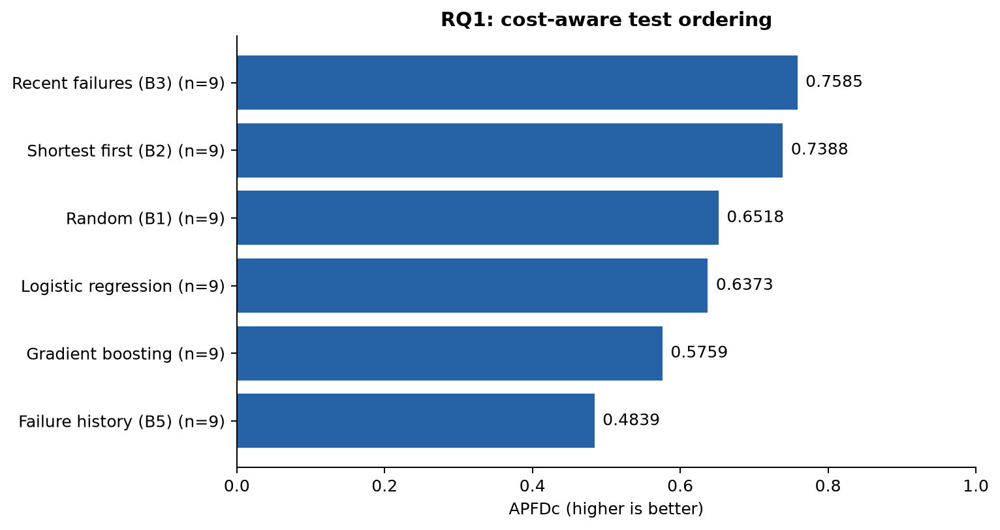
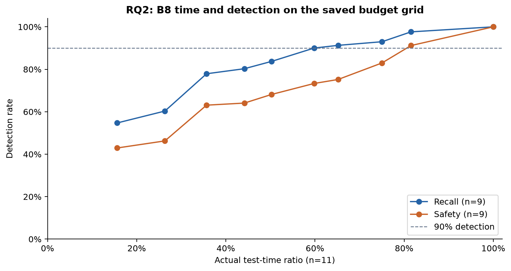
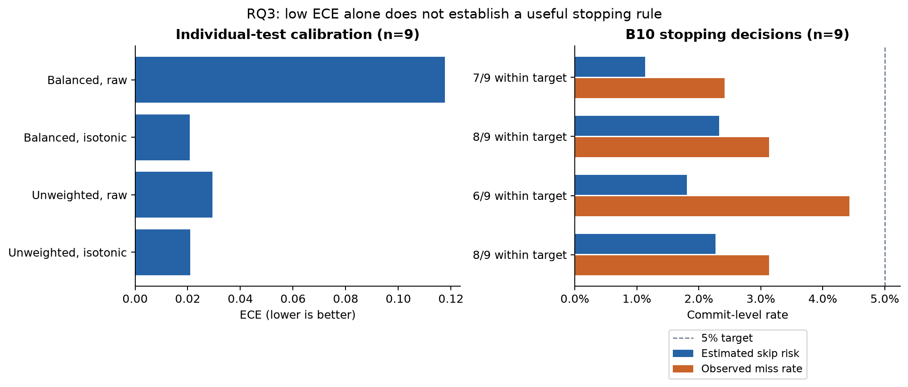
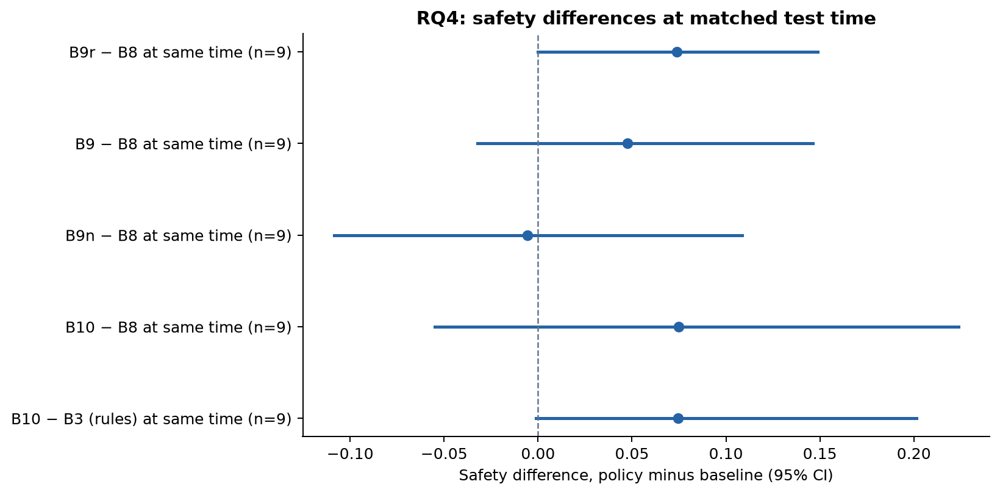
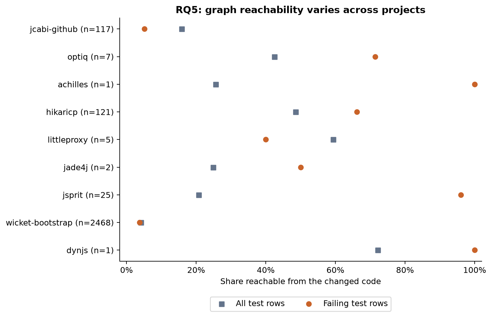

# CodeDNA: evaluation chapter (draft)

Draft of the methods, results and threats-to-validity chapters for the FYP
report, covering research questions RQ1 to RQ5 (docs/RESEARCH_PLAN.md).
Every number comes from files under `experiments/results/`; the source of
each table is named. Status: evaluation draft with reproducible figures, 2026-10-24.

## 1. Research questions

- **RQ1.** How accurately do structural, change and historical features
  predict regression-test failures?
- **RQ2.** How much test execution time can be saved at given empirical
  failure-detection targets?
- **RQ3.** Does probability calibration improve the reliability of
  test-risk estimates?
- **RQ4.** Does uncertainty-aware fallback improve the safety/cost
  trade-off?
- **RQ5.** Do graph-derived features improve prediction enough to justify
  their cost?

## 2. Method

### 2.1 Data

We use RTPTorrent v1.1 (Mattis, Rein, Dürsch and Hirschfeld, MSR 2020;
Zenodo record 4046180, CC BY 4.0; archive md5
`1f7fa822b0cf155bd007a94d1a24a336`). It holds Travis CI test results at
test-class level for 20 open-source Java projects (2007 to 2016), the links
from CI jobs to Git commits, and the projects' Git repositories. Using
recorded CI outcomes means no third-party code is built or executed.

`codedna history import-rtptorrent` imports one project at a time. A CI job
can cover several commits; the tested commit is the single tip of the job's
commits, and its change is measured against the state before the push. A
test class can appear several times in one job (one run per module); those
runs are merged, and the class counts as failed if any run failed. A commit
counts as failing if any of its jobs records a failure (D-021). Eleven
projects were imported; their job counts match Table 2 of the RTPTorrent
paper (docs/DATASET_PLAN.md).

### 2.2 Features

Each (commit, test class) pair becomes one row with 19 features, computed
only from information available before the commit (D-023):

| Group | Features |
|---|---|
| Change (6) | files, Java files, non-Java files and test files changed; lines added and deleted |
| Test (1) | whether the test class itself changed |
| Structural (3) | whether the dependency graph reaches the test from the change, the distance, and whether the path is confirmed |
| History (9) | past runs, past failures, failure rate, failures in the last 5 runs, failed last run, commits since last failure, mean and last duration, co-failures |

The structural features come from CodeDNA's dependency graph: Java files are
parsed with tree-sitter, class-level edges (extends, implements, uses,
imports, static access) are labelled confirmed or heuristic, and impact is a
reverse breadth-first search over the merged before/after graphs.

### 2.3 Split, models and seeds

Commits are split chronologically: oldest 60 % train, next 20 %
validation, latest 20 % test. Nothing is shuffled. Two classifiers are
trained on the training split with scikit-learn: logistic regression and
histogram gradient boosting, both with balanced class weights (the rare
failing rows are up-weighted). Selection experiments use gradient boosting.
A separate check trains the same model without class weights, as a stricter
uncalibrated baseline for RQ3 (D-037). Calibrators (Platt scaling and isotonic
regression) are fitted on the validation split only. Every experiment is run
with five seeds (0 to 4); seeds change model randomness only, not the split.

### 2.4 Orderings and selection policies

Orderings (RQ1): random (B1), shortest first (B2), recent failures then
shortest (B3), failure history (B5), logistic regression and gradient
boosting.

Selection policies (RQ2, RQ4), each applied to every test commit:

| Policy | Rule |
|---|---|
| B0 | run every test |
| B4 | dependency only: tests the graph reaches from the change, plus changed tests |
| B6 | change-only model, 50 % time budget |
| B7 | full model, uncalibrated, 50 % budget |
| B8 | full model, calibrated, 50 % budget |
| B9 | B8 plus risk target 0.05 with fallback, plus the unfamiliar-change rule |
| B9r | B8 plus risk-target fallback only |
| B9n | B8 plus unfamiliar-change rule only (non-Java files changed, or most tests without history, means run everything) |
| B3 | rules order (recent failures, then shortest), 50 % budget |
| B10 | hybrid: rules order, no budget; add tests until the calibrated estimated skip risk is at most 0.05 |

Model-based policies take tests in order of probability per second of
expected run time. The estimated skip risk of a selection is
1 − Π(1 − p) over the skipped tests, which assumes independent failures.

### 2.5 Metrics

- Ordering: APFD and APFDc (cost-aware), failing-test recall at 25 % and
  50 % of test time.
- Prediction: PR-AUC.
- Calibration: Brier score and expected calibration error (ECE, 10
  equal-width bins); per commit, the mean absolute gap between estimated
  skip risk and observed miss rate.
- Selection: test-time ratio (selected test time / full run time),
  failing-test recall, and commit safety (share of failing commits where
  every failing test was selected).

### 2.6 Fair comparison and uncertainty

A policy that runs more tests usually catches more failures. To separate
better decisions from more testing, each policy of interest is compared
with a baseline whose budget is tuned by bisection so that it spends the
same real test time (D-035): B9, B9r, B9n and B10 against B8, and B10 also
against B3.

Point estimates are means over the five seeds. 95 % intervals come from a
hierarchical percentile bootstrap: pick a seed, then resample that seed's
test commits (paired between policy and baseline). Pooled results average
the projects with equal weight, resampling within each project, and report
how many projects contribute (a project without failing test commits has no
recall or safety).

### 2.7 Figure provenance

The five figures are generated from saved reports by
`scripts/make_study_figures.py` (D-038), without retraining or rebuilding the
feature datasets. Their exact values and project cohorts are in
`experiments/results/study11-2026-10-21/figures/figure-data.json`; the adjacent
`manifest.json` fingerprints the input reports, exporter and artifacts.
Raw/calibrated comparisons use common project cohorts. No confidence intervals
are derived from standard deviations over random seeds.

## 3. Data actually available

Source: `experiments/results/study11-2026-10-21/summary.md`.

| Project | Test commits | With failures | Failing rows |
|---|---|---|---|
| graylog2-server | 879 | 0 | 0.0 % |
| jOOQ | 258 | 0 | 0.0 % |
| jcabi-github | 118 | 52 | 0.7 % |
| optiq | 91 | 4 | 0.14 % |
| Achilles | 101 | 1 | 0.01 % |
| HikariCP | 286 | 20 | 2.0 % |
| LittleProxy | 53 | 5 | 0.26 % |
| jade4j | 63 | 2 | 0.12 % |
| jsprit | 52 | 7 | 0.52 % |
| wicket-bootstrap | 164 | 87 | 30.4 % |
| dynjs | 75 | 1 | 0.02 % |

graylog2-server and jOOQ have no failing test commits: their CI logs record
far fewer test classes in the test period (about 1 and 7 per commit), which
we attribute to changes in the projects' CI rather than to the importer
(stored and derived failure counts agree). They contribute to time and
calibration results but not to recall or safety, so those pooled results
use n = 9 projects. Several of the nine have fewer than ten failing test
commits, so per-project results for them are close to anecdotes.

## 4. Results

### 4.1 RQ1: predicting failures

Gradient boosting with all 19 features reaches a pooled PR-AUC of 0.138
(n = 9), far above the failure base rate on most projects (for example
jcabi-github 0.163 against 0.007, optiq 0.357 against 0.0014, HikariCP 0.039
against 0.020, wicket-bootstrap 0.635 against 0.304). The features carry
real signal.

Ablations (pooled PR-AUC; `summary.md`, "Ablations"): all features 0.138,
without history 0.080, without change 0.098, without structural 0.119.
History features matter most. On projects with very few failures the
ablations are unstable (on jade4j the model *without* history scores
0.251 against 0.016 with all features), a sign of overfitting to a handful
of failing rows.

Turning predictions into an *ordering* is a different matter (source:
`summary.md`, "Ordering", n = 9):

| Ordering | APFD | APFDc | Recall at 25 % time | Recall at 50 % time |
|---|---|---|---|---|
| Recent failures, then shortest (B3) | 0.511 | **0.759** | 0.578 | 0.714 |
| Shortest first (B2) | 0.427 | 0.739 | 0.572 | 0.702 |
| Random (B1) | 0.627 | 0.652 | 0.505 | 0.635 |
| Logistic regression | **0.644** | 0.637 | 0.428 | 0.619 |
| Gradient boosting | 0.612 | 0.576 | 0.378 | 0.527 |
| Failure history (B5) | 0.588 | 0.484 | 0.263 | 0.418 |

Logistic regression has the best APFD, which ignores test duration. Once
duration counts (APFDc, recall at a time budget), the time-aware rules win
and both learned models are at or below random. The best ordering by APFDc
is a simple rule on six of the nine projects.

Figure 1. APFDc of the saved orderings; n is the number of projects with a defined metric.

**Answer to RQ1.** The features predict failures well above chance, mainly
through test history. The learned models do not order tests better than
simple time-aware rules on this data.

### 4.2 RQ2: time saved at a detection target

Pooled budget sweep of the calibrated selector B8 (mean over projects of the
mean over seeds; `experiment-seed*.json`, `risk_coverage`):

| Budget | Time | Recall | Safety |
|---|---|---|---|
| 0.3 | 0.36 | 0.78 | 0.63 |
| 0.5 | 0.50 | 0.84 | 0.68 |
| 0.6 | 0.60 | 0.90 | 0.73 |
| 0.8 | 0.75 | 0.93 | 0.83 |
| 0.9 | 0.82 | 0.98 | 0.91 |

To catch 90 % of failing tests the selector needs about 60 % of the full
test time (a 40 % saving); to run every failing test on 90 % of failing
commits it needs about 82 % (an 18 % saving). The hybrid B10 (section 4.4)
reaches recall 0.94 and safety 0.88 at 61 % of the time with a 1 % risk
target, but that pooled comparison is not cost-matched per project and is
driven by wicket-bootstrap.

Figure 2. B8 detection rates against actual mean test time. Time pools eleven projects; recall and safety pool nine. These pooled curves are descriptive, not per-project cost-matched comparisons.

**Answer to RQ2.** Savings of about 40 % are possible at 90 % recall, but
much smaller savings if every failing commit must be fully caught. The
curve is project-specific: wicket-bootstrap only becomes safe above about
80 % of the test time.

### 4.3 RQ3: calibration

| | Uncalibrated | Platt | Isotonic |
|---|---|---|---|
| ECE (pooled) | 0.100 (n = 11) | 0.022 (n = 9) | 0.021 (n = 9) |
| ECE, same 9 projects | 0.118 | 0.022 | 0.021 |
| Brier (pooled) | 0.075 (n = 11) | 0.021 (n = 9) | 0.022 (n = 9) |

Achilles and jsprit have no failures in their validation split, so no
calibrator could be fitted. On the nine others ECE fell on eight and stayed
equal on one (jade4j). At commit level, the mean absolute gap between the
estimated skip risk and the observed miss rate fell from 0.274 (B7,
uncalibrated) to 0.078 (B8, calibrated), improving on 7 of 11 projects and
getting worse on LittleProxy (0.22 to 0.27).

The balanced class weights used for training push raw probabilities up,
so the uncalibrated column above is a weak baseline. Training the same
model without class weights gives a stricter one (`class-weight-summary.md`,
same 9 projects, mean over 5 seeds):

| | Balanced, raw | Balanced, isotonic | Unweighted, raw | Unweighted, isotonic |
|---|---|---|---|---|
| ECE | 0.118 | 0.021 | 0.030 | 0.021 |
| Brier | 0.090 | 0.022 | 0.029 | 0.023 |
| Skip-risk gap, 50 % budget | 0.306 | 0.067 | 0.054 | 0.071 |
| PR-AUC (n = 9) | 0.138 | | 0.103 | |

The unweighted model is already well calibrated. Calibrating it lowers ECE
on 5 of 9 projects and raises it on 4; the clear gains are on the two
projects with the most failures (wicket-bootstrap 0.171 to 0.102, HikariCP
0.020 to 0.013). Its commit-level risk estimate is as close to the observed
miss rate as any calibrated variant. Balanced weights, on the other hand,
rank failures better (PR-AUC 0.138 against 0.103, much of it from optiq,
which has four failing test commits).

The ECE comparison does not show how the probabilities behave in a
decision. The same check therefore ran the hybrid policy B10 (section 4.4:
rules order, stop when the estimated skip risk is at most 0.05) with each
model's raw and isotonic probabilities (`class-weight-summary.md`):

| B10 (target 0.05), same 9 projects | Time | Recall (n = 7) | Safety (n = 7) | Est. risk | Observed miss | Within 5 % |
|---|---|---|---|---|---|---|
| Balanced, isotonic (the study's model) | 0.36 | 0.80 | 0.72 | 0.023 | 0.031 | 8 of 9 |
| Balanced, raw | 0.56 | 0.71 | 0.65 | 0.011 | 0.024 | 7 of 9 |
| Unweighted, raw | 0.26 | 0.50 | 0.46 | 0.018 | 0.044 | 6 of 9 |
| Unweighted, isotonic | 0.35 | 0.80 | 0.68 | 0.023 | 0.031 | 8 of 9 |

With the unweighted model's raw probabilities B10 stops far too early: it
spends 26 % of the test time, is safe on only 46 % of failing commits, and
misses failures on 4.4 % of commits while estimating 1.8 %, breaking the
target on 3 of 9 projects. Calibrating the same model restores the target
on 8 of 9 and matches the study's model almost exactly. A stopping rule
sums the small probabilities of every skipped test, so a slight
underestimate of rare failures, invisible in ECE, becomes a large
underestimate of commit risk.

Figure 3. Calibration and B10 stopping on matching nine-project cohorts. Labels count projects within the 5% target; a pooled mean below target does not imply that every project met it.

**Answer to RQ3.** Calibration makes the class-weighted model's
probabilities and commit-level risk estimates far more reliable (ECE 0.118
to 0.021, risk gap 0.306 to 0.067). Most of the ECE gain undoes the class
weighting: a model trained on the natural failure rate has a low ECE
without a calibrator. Calibration is nevertheless what makes the risk
estimate usable for decisions: without it, a risk-target stopping rule
breaks its target on a third of the projects; with it, the target holds on
8 of 9, whichever way the model was trained.

### 4.4 RQ4: fallback and risk-based stopping

At default settings the fallback policies look much safer than B8 (pooled
safety 0.68 for B8; 0.84 B9r, 0.85 B9n, 0.93 B9), but they also spend more
time (0.50 against 0.61, 0.77, 0.82). At the same test time
(`summary.md`, "Policies vs baselines at the same test time"):

| Comparison (same time) | Safety Δ [95 % CI] | Recall Δ [95 % CI] |
|---|---|---|
| B9r (risk fallback) − B8 | +0.074 [0.000, 0.149] | +0.003 [−0.005, 0.013] |
| B9n (unfamiliar-change rule) − B8 | −0.006 [−0.109, 0.109] | −0.018 [−0.114, 0.092] |
| B9 (both) − B8 | +0.048 [−0.032, 0.146] | +0.009 [−0.067, 0.096] |
| B10 (hybrid) − B8 | +0.075 [−0.055, 0.224] | +0.012 [−0.086, 0.074] |
| B10 (hybrid) − B3 (rules) | +0.075 [−0.001, 0.202] | +0.017 [−0.012, 0.063] |

B9r equals B8 on eight of nine projects; all its gain comes from
wicket-bootstrap, where one expensive test fails repeatedly and a plain
budget only becomes safe above about 80 % of the time. The unfamiliar-change
rule helps jcabi-github (+0.15) and HikariCP (+0.15) and hurts
wicket-bootstrap (−0.30).

The hybrid B10 (rules order, calibrated stopping, D-036) is never lower in
safety than the rules at the same time on any project (higher on four,
equal on five), and with a 5 % target its observed miss rate stays within
5 % on 10 of 11 projects (pooled observed 2.8 %, estimated 2.6 %). The
exception is jcabi-github (observed 20 %, estimated 4.4 %). With stricter
targets (1 to 2 %) the estimates are too optimistic on four projects.

Figure 4. Saved pooled safety differences and hierarchical bootstrap 95% intervals. Intervals touching or crossing zero do not establish an improvement.

**Answer to RQ4.** Fallback does not reliably improve the trade-off once
cost is matched; it helps only where failures are frequent and concentrated
(wicket-bootstrap). The best use of the calibrated model is as a stopping
rule on top of a simple ordering (B10): it is consistently at least as good
as the alternatives and gives a risk statement that mostly holds, but its
pooled advantage is not statistically clear.

### 4.5 RQ5: the dependency graph

Removing the three structural features lowers PR-AUC on jcabi-github
(−0.072, 4 of 5 seeds), optiq (−0.080, 5 of 5) and HikariCP (−0.013, 5 of 5)
and changes it by at most 0.001 elsewhere. On the test split, the share of
failing (commit, test) rows that the graph reaches from the change, against
the share of all rows, is 0.96 against 0.21 on jsprit and 0.66 against 0.49
on HikariCP, but 0.05 against 0.16 on jcabi-github and 0.04 against 0.04 on
wicket-bootstrap. Graph-only selection (B4) does well on jsprit (time 0.41,
safety 0.86, against B8's 0.35 and 0.71) and catches almost nothing on
jcabi-github and wicket-bootstrap (safety 0.06 and 0.04).

Figure 5. Reachability among all and failing test rows. n counts failing rows; estimates with very few failures are unstable. Reachability alone does not establish the cause of a failure.

**Answer to RQ5.** Graph features help on some projects, while reachability
is weak on others. These associations do not identify failure causes. The
graph is a useful component, not a decisive one, on this data.

### 4.6 Additional validation: cross-project transfer (D-039)

The original eleven-project study trains a separate model for each project.
A new, pre-specified check tests actual model transfer on HikariCP, LittleProxy,
jade4j and wicket-bootstrap. All 12 directions and four fresh within-project
controls use five seeds (80 raw evaluations). Source fitting is restricted to
history older than target testing by Git committer date; calibration uses source
labels only. Prior target outcomes remain available as historical features.

Only nine transfer directions have usable source calibration; jade4j's three
eligible source calibration windows lack both classes. Seven of those nine meet
the observed 5% miss target. HikariCP to LittleProxy misses all recorded target
failures (9.43% observed miss, estimated 4.40%). LittleProxy to wicket-bootstrap
has 16.46% observed miss against estimated 3.48%, despite 98.30% failure recall.
Wicket-bootstrap to the other projects uses 97.84–99.96% of full test time.
Raw-model ordering beats rules in only three of twelve directions, and source
calibration worsens target ECE in six of nine available directions.

There are useful individual pairs: HikariCP to wicket-bootstrap uses 72.51% time
with 98.85% commit safety and 0.61% observed miss; its safety gain against rules
at matched time is +0.1034 [0.0449, 0.1711]. This pairwise interval has no
multiple-comparison correction. Some transfer can work, but there is no reliable
general transfer result. All four within-project controls meet the observed
miss target, though one runs the whole suite and jade4j has only two failing
commits among 63; even skipping all its tests meets the unconditional 5% target.

The project should retain target-project validation before trusting a transferred
stopping-risk estimate. This limits deployment claims rather than invalidating
the original within-project findings. Source:
`experiments/results/cross-project-2026-10-24/summary.json` and `FINDINGS.md`;
protocol, all pair/seed reports, recovered-data hashes and package versions are
saved alongside them. Original study reports remain unchanged.

### 4.7 Additional validation: stopping across historical orderings (D-040)

A separately fixed four-project/five-seed extension applies B10 to a history-only
adaptation of the DANTE author artifact’s score. It retains historical failure
rate, inverse-lag conditional stickiness and CCH density, while omitting commit
relevance and using observed test-class lags. This is an independently implemented
adaptation, not full-DANTE reproduction. A preliminary transition proxy is also
archived; both extensions reuse previously inspected windows and are exploratory.

Calibrated stopping meets the observed unconditional 5% miss target on all four
projects for both adapted and rules orders. Raw stopping with the adapted order
fails on HikariCP (5.59%) and wicket-bootstrap (9.64%). Adapted-order calibrated
stopping versus a same-order budget baseline at matched actual cost has pooled
safety difference +0.0460 [-0.0500, 0.2806], and recall difference -0.0056
[-0.0420, 0.0312]. These intervals do not establish a benefit. HikariCP spends
29.39% time under the adapted calibrated order versus 13.33% under rules, with
71.90% versus 72.73% recall. Simple rules therefore remain the live default.

The results support evaluating stopping separately from ordering, but cannot
establish reliability for arbitrary orders or superiority over published DANTE.
Small failure counts, dependent commits and non-confirmatory reuse remain limits.
Source: `experiments/results/dante-history-check-2026-10-24/summary.json` and
`FINDINGS.md`. The separate live 15-feature evidence gate is an engineering
addition, not an empirically demonstrated abstention improvement from this study.

## 5. Threats to validity

- **Construct.** Results are per test class, not per test method. "Commit
  safety" counts a commit as safe only if every failing class was run; a
  flaky failure counts like a real one, because RTPTorrent does not mark
  flakiness.
- **Calibration baseline.** Both models are trained with balanced class
  weights, which pushes raw probabilities upwards. Section 4.3 therefore
  also reports an unweighted model; most of the calibration gain turns out
  to correct the class weighting. B10 was also run with the unweighted
  model: it needs calibration to keep its target (section 4.3).
- **Independence.** The skip-risk formula assumes test failures are
  independent; one bug often breaks several tests. Bootstrap intervals treat
  test commits as independent, but neighbouring commits are correlated, so
  the intervals are somewhat optimistic.
- **Internal.** Splits are chronological and features use only earlier
  commits, so no future information leaks. Seeds change only model
  randomness; the fixed split means intervals do not cover other periods.
- **Transfer.** The added four-project check includes only one model/protocol,
  historical target features and fixed target windows. Source-only calibration
  is unavailable in three directions and violates its observed miss target in
  two others. Target risk must be validated rather than inferred from source
  calibration.
- **External.** Eleven open-source Java projects from 2007 to 2016 on
  Travis CI. Two have no evaluable failures, several have very few, and one
  project (wicket-bootstrap) drives most selection differences. The results
  may not transfer to modern or industrial CI.
- **Reliability.** Every number comes from the stored data and saved reports;
  dataset hashes, package versions and commands are recorded
  in each report, and rerunning the experiments reproduced earlier numbers
  exactly.

## 6. Conclusion

CodeDNA's clearest contribution is an honest, checked estimate of the risk
of skipping tests, together with an evaluation that compares selection
policies at equal test time. Held-out calibration is what makes that
estimate usable as a stopping rule, even though much of its gain in ECE
only undoes class weighting. Learned models predict failures above chance
but do not order tests better than simple rules, and fallback mainly buys
safety with extra test time. Using simple rules to choose *which* tests run
and the calibrated model to choose *how many* (B10) is at least as good as
either alone on every project studied and mostly keeps its stated risk,
though the gain is not statistically clear on this data. These statements concern
within-project fitting; the additional four-project transfer check does not
establish a generally reliable source-trained model or risk estimate.
