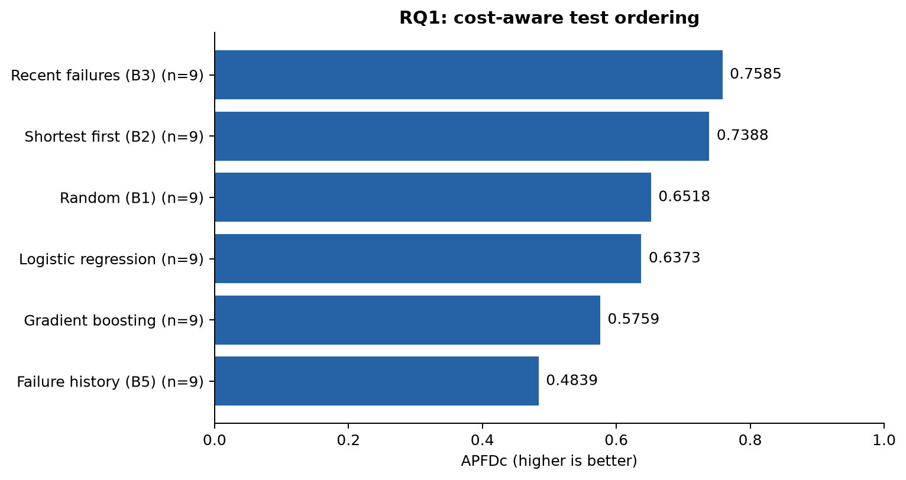
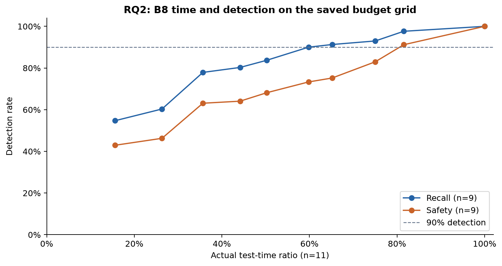
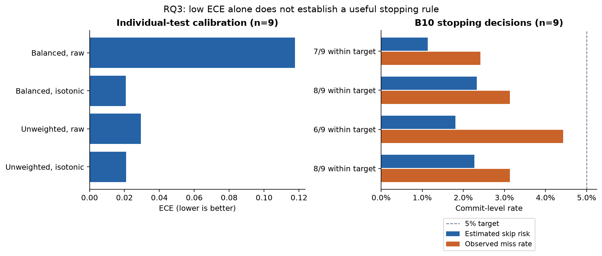
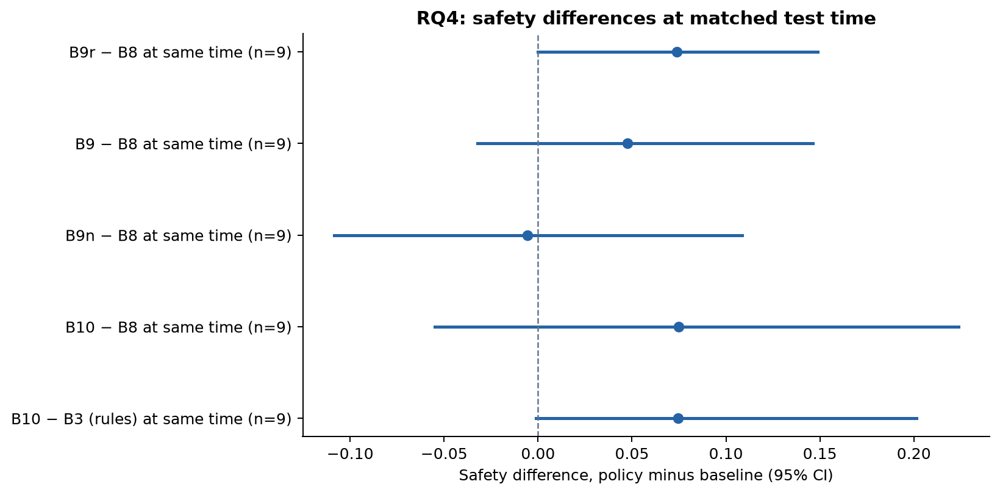
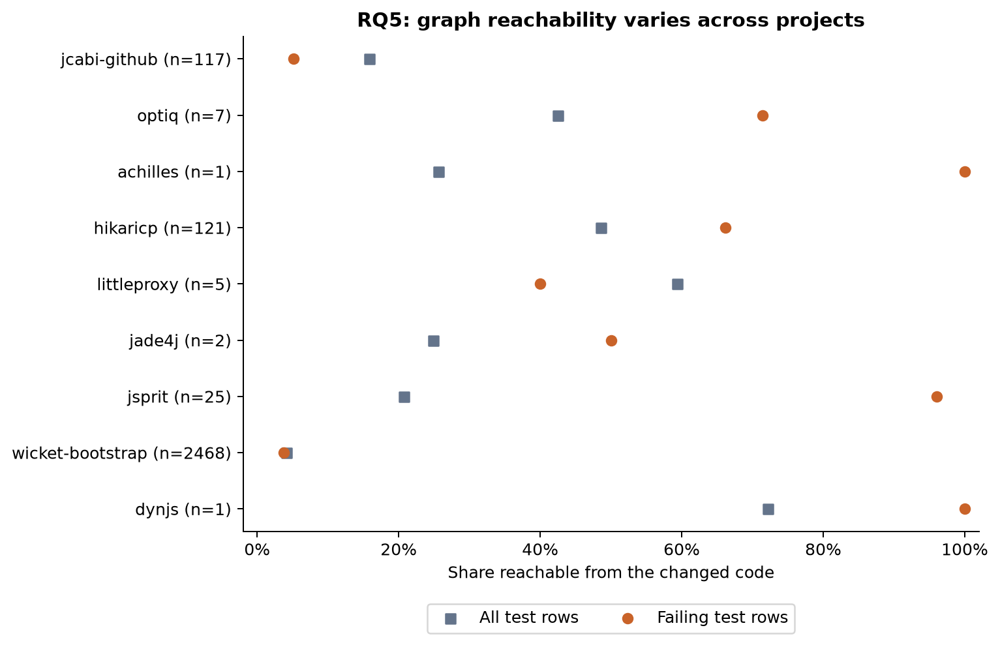

# Saved-study figures

Generated by `scripts/make_study_figures.py`.

Means weight projects equally after averaging seeds. Missing metrics remain null;
projects without failures do not count toward recall or safety. Model fitting and
dataset extraction are not rerun. Source reports and their SHA-256 hashes are in
`manifest.json`; exact plotted values and project counts are in `figure-data.json`.

Reproduce from the repository root:

```powershell
python -m pip install -e ".[plots]"
python scripts/make_study_figures.py --study "experiments/results/study11-2026-10-21"
```

## Ordering quality

APFDc is cost-aware. Means over seeds, then projects; no confidence intervals are inferred from seed spread.



[Vector figure](rq1-ordering.svg)

## Time and detection

B8 budget sweep. Each point shows actual time spent, not the requested budget. Time and detection may have different contributing project counts.



[Vector figure](rq2-budget.svg)

## Calibration and stopping decisions

All four variants use the same available project cohort within each panel. Estimated risk and observed miss rate refer to B10, not individual-test ECE. A pooled mean below target does not mean every project met it.



[Vector figure](rq3-calibration.svg)

## Safety at matched test time

Saved hierarchical bootstrap 95% intervals. Intervals touching or crossing zero do not establish an improvement. Time matching is approximate; exact time differences are in figure-data.json.



[Vector figure](rq4-cost-matched.svg)

## Dependency-graph reachability

All projects with defined reachability are shown. n counts failing test rows, not independent faults. Sparse projects have unstable estimates; reachability does not establish failure causation.



[Vector figure](rq5-graph-signal.svg)
